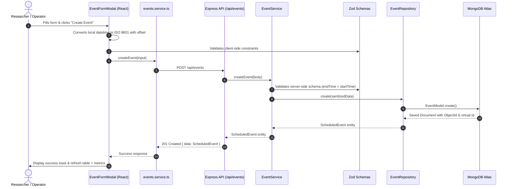

# Component 4: Event Intelligence & Context-Aware Feature Engineering — Final Technical Manual

**Research Project:** AI-Based Adaptive Caching for Mitigating Data Communication Overhead in Microservice Architectures  
**Research Component:** Component 4 — Event-Driven Orchestration and Experimental Framework (Event Intelligence & Context-Aware Feature Engineering)  
**Document Designation:** `final.md` (Definitive Codebase & Architectural Specification)  
**Status:** Completed up to Phase 3.3 (Full-Stack Event Management, Persistence, Validation, and Interactive UI)  
**Target Monorepo:** `component-4` (`packages/shared`, `apps/api`, `apps/web`)

---

## 1. Executive Summary & Research Framework

### 1.1 Research Context & Objectives
In modern distributed microservice architectures, data communication overhead between services frequently degrades throughput, inflates tail latency, and overburdens shared database tiers. Traditional caching mechanisms (e.g., standard LRU/LFU policies or static TTLs) operate reactively based solely on cache hit/miss history. They are fundamentally blind to planned, external, and recurring business events that cause massive, predictable traffic surges (e.g., semester exam result publications, course registration openings, flash sales, or urgent system announcements).

**Component 4 (Event Intelligence & Context-Aware Feature Engineering)** solves this deficiency by acting as the system's predictive intelligence backbone. It captures scheduled real-world events, enriches them with structural metadata (target services, expected load spikes, priority, affected resources, and geographic/campus scope), verifies temporal constraints, and prepares clean, context-aware event features. These features are subsequently consumed by downstream AI/ML cache decision engines (Components 1–3) to proactively warm caches, pre-populate distributed replicas, and dynamically modulate TTLs *prior* to load onset.

### 1.2 System Scope & Architecture
Component 4 is structured as a production-grade TypeScript monorepo powered by **npm workspaces**, adhering to strict domain-driven separation of concerns:

```
┌────────────────────────────────────────────────────────────────────────┐
│                        apps/web (React 19 + Vite)                      │
│   - Unified Event Management Dashboard (Summary Metrics, Filters)      │
│   - Timezone-Aware Create & Edit Modal with Optimistic UI & Validation │
└────────────────────────────────────┬───────────────────────────────────┘
                                     │ HTTP / REST (/api/events)
                                     ▼
┌────────────────────────────────────────────────────────────────────────┐
│                      apps/api (Node.js + Express)                      │
│   - Express REST Router with Helmet, CORS, and Async Handlers          │
│   - Zod Request Body & Query Validation Filter                         │
│   - Event Service & Domain Business Logic Layer                        │
│   - Event Repository (Atomic Operations, Transactions, Safe Queries)   │
│   - Mongoose Persistence Model & Lifecycle Connection Manager          │
└───────────────────┬────────────────────────────────┬───────────────────┘
                    │                                │
                    ▼                                ▼
       ┌────────────────────────┐      ┌───────────────────────────────┐
       │     packages/shared    │      │         MongoDB Atlas         │
       │  - Shared TypeScript   │      │  - Clustered Persistence      │
       │    Data Contracts      │      │  - Multi-Key Compound Indexes │
       │  - Zod Runtime Schemas │      │  - High Availability Replica  │
       │  - University Fixtures │      └───────────────────────────────┘
       └────────────────────────┘
```

---

## 2. Implementation Milestones Completed

| Phase | Title | Scope & Deliverables | Verification Status |
| :--- | :--- | :--- | :--- |
| **Part 1.1** | **Monorepo Foundation** | Scaffolding `npm` workspaces (`apps/*`, `packages/*`), strict TypeScript configurations, root scripts, and baseline Express/React health check scaffolding. | ✅ Complete |
| **Part 1.2** | **Event Domain Contracts** | Comprehensive shared TypeScript domain contracts: `ScheduledEvent`, `CreateScheduledEventInput`, `UpdateScheduledEventInput`, `ListEventsQuery`, `EventListResponse`, `PaginationMeta`, and core enums (`EventType`, `ExpectedLoad`, `EventPriority`, `EventStatus`). | ✅ Complete |
| **Part 1.3** | **Zod Runtime Validation** | Strict runtime validation schemas enforcing ISO 8601 offset strings, non-empty arrays, string sanitization, and cross-field temporal checks (`endTime > startTime`). | ✅ Complete |
| **Part 1.4** | **Event Fixtures & Seed Data** | Deterministic, domain-realistic university test fixtures (`FIXTURE_RESULT_RELEASE`, `FIXTURE_REGISTRATION_OPENING`, `FIXTURE_CAMPUS_MAINTENANCE`, `FIXTURE_HOLIDAY_PERIOD`, `FIXTURE_IN_PROGRESS_REGISTRATION`, `SAMPLE_SCHEDULED_EVENTS`). | ✅ Complete |
| **Part 2.1** | **MongoDB Atlas Connection** | Resilient Mongoose connection lifecycle manager featuring DNS resolution retry, 5-second socket timeouts, connection pooling, URI credential masking, and clean SIGINT/SIGTERM shutdown hooks. | ✅ Complete |
| **Part 2.2** | **Mongoose Persistence Model** | Strongly typed Mongoose persistence schema with compound indexing (`{ status: 1, startTime: 1 }`, `{ targetServices: 1 }`), virtual id mappings, and MongoDB-to-domain transformation plugins. | ✅ Complete |
| **Part 2.3** | **Event Repository Layer** | Repository pattern implementing `IEventRepository` with atomic CRUD, regex-sanitized search queries, bounded pagination, duplicate key conflict translation, and replica transaction awareness. | ✅ Complete |
| **Part 2.4** | **Integration Testing & Safety** | Dual-tier testing architecture: fast in-memory MongoDB runner (`mongodb-memory-server`) and live Atlas integration testing secured by strict DB name safety assertions preventing accidental staging/prod wipes. | ✅ Complete |
| **Part 3.1** | **Event Management REST API** | RESTful Express endpoints (`POST /api/events`, `GET /api/events`, `GET /api/events/:id`, `PATCH /api/events/:id`, `DELETE /api/events/:id`, `GET /api/health/ready`) with centralized error handling and Zod validation. | ✅ Complete |
| **Part 3.2** | **Dashboard Foundation** | Dark charcoal/navy React dashboard featuring live system readiness indicator, aggregate metric cards (Total, Active, Critical, High Load), debounced search, status/priority filters, and responsive layout. | ✅ Complete |
| **Part 3.3** | **Create & Edit Event Workflows** | Interactive modal dialog with timezone-aware datetime conversions (`datetimeLocalToIso`, `isoToDatetimeLocal`), real-time client-side Zod validation, and duplicate submission locks. | ✅ Complete |
| **Part 3.4** | **Event Details & Lifecycle Actions** | Full Event Details inspection view, safe cancellation with lifecycle state validation (`POST /api/events/:eventId/cancel`), permanent deletion (`DELETE /api/events/:eventId`), confirmation dialogs, and instant dashboard synchronization. | ✅ Complete |

---

## 3. Comprehensive Repository Directory Structure

```
component-4/
├── .env                                  # Local development environment configuration
├── .env.example                          # Safe environment variable template with documentation
├── .gitignore                            # Git exclusion rules for node_modules, build artifacts, logs
├── package.json                          # Root workspace package orchestrator (scripts: build, test, dev)
├── package-lock.json                     # Deterministic dependency tree lockfile
├── tsconfig.base.json                    # Shared base TypeScript configuration (Strict mode, ES2022)
├── README.md                             # Original introductory project README
├── final.md                              # This definitive codebase & architectural specification
│
├── apps/
│   ├── api/                              # Backend Express Application (@component4/api)
│   │   ├── package.json                  # API dependencies and lifecycle scripts
│   │   ├── tsconfig.json                 # API TypeScript project configuration extending tsconfig.base.json
│   │   ├── vitest.config.ts              # API Vitest testing configuration with environment isolation
│   │   ├── src/
│   │   │   ├── index.ts                  # Process entry point initiating DB connection and HTTP server
│   │   │   ├── app.ts                    # Express application factory mounting middleware and route trees
│   │   │   ├── server.ts                 # HTTP server lifecycle, port binding, and graceful termination hooks
│   │   │   ├── config/
│   │   │   │   ├── environment.ts        # Zod environment validation schema & URI masking helper
│   │   │   │   └── index.ts              # Configuration module barrel export
│   │   │   ├── infrastructure/
│   │   │   │   └── database/
│   │   │   │       ├── mongodb.ts        # Resilient Mongoose connection manager with reconnection logic
│   │   │   │       └── index.ts          # Database module barrel export
│   │   │   ├── models/
│   │   │   │   ├── event.model.ts        # Mongoose schema, compound indexes, and document interface
│   │   │   │   └── index.ts              # Model module barrel export
│   │   │   ├── repositories/
│   │   │   │   ├── errors.ts             # Domain-level repository exceptions (NotFound, Duplicate, Validation)
│   │   │   │   ├── event.repository.ts   # Concrete MongoDB event repository implementing IEventRepository
│   │   │   │   └── index.ts              # Repository module barrel export
│   │   │   ├── errors/
│   │   │   │   ├── http-errors.ts        # Structured HTTP exception hierarchy (BadRequest, NotFound, Conflict)
│   │   │   │   └── index.ts              # HTTP errors barrel export
│   │   │   ├── middleware/
│   │   │   │   ├── async-handler.ts      # Promise wrapper preventing uncaught asynchronous exceptions
│   │   │   │   ├── error-handler.ts      # Global Express error handler translating errors to ApiErrorResponse
│   │   │   │   └── index.ts              # Middleware module barrel export
│   │   │   ├── services/
│   │   │   │   ├── event.service.ts      # Business logic, Zod validation enforcement, and repository orchestration
│   │   │   │   └── index.ts              # Services module barrel export
│   │   │   ├── controllers/
│   │   │   │   ├── event.controller.ts   # Express route handlers parsing HTTP requests and formatting responses
│   │   │   │   └── index.ts              # Controller module barrel export
│   │   │   └── routes/
│   │   │       ├── health.ts             # Process liveness (/health) and Atlas readiness (/health/ready) routes
│   │   │       ├── event.routes.ts       # Event management REST routes (/api/events)
│   │   │       └── index.ts              # Routes module barrel export
│   │   └── tests/
│   │       ├── config.test.ts            # Environment validation & URI sanitization unit tests
│   │       ├── mongodb.test.ts           # Connection manager mock & lifecycle tests
│   │       ├── server.test.ts            # Express server bootstrap & shutdown unit tests
│   │       ├── health.test.ts            # Health route HTTP integration tests
│   │       ├── event.model.test.ts       # Mongoose model schema & index verification tests
│   │       ├── event.repository.test.ts  # In-memory repository CRUD & transaction unit tests
│   │       ├── event.routes.test.ts      # REST API route handler & validation tests
│   │       ├── test-db-safety.test.ts    # Database safety assertion unit tests
│   │       └── integration/
│   │           ├── test-db.ts            # In-memory MongoDB helper with connection pooling
│   │           ├── atlas.integration.test.ts          # Direct Atlas cluster connectivity verification
│   │           ├── event.repository.integration.test.ts # Live Atlas repository persistence tests
│   │           └── event.api.integration.test.ts       # End-to-end Supertest API integration tests
│   │
│   └── web/                              # Frontend React Dashboard Application (@component4/web)
│       ├── package.json                  # Web dependencies (React 19, Lucide icons) and scripts
│       ├── tsconfig.json                 # Web TypeScript configuration with DOM typings
│       ├── vite.config.ts                # Vite build configuration with /api reverse proxy
│       ├── vitest.config.ts              # Frontend Vitest configuration with jsdom environment
│       ├── index.html                    # Single Page Application HTML root entry point
│       ├── src/
│       │   ├── main.tsx                  # React DOM rendering root mounting App component
│       │   ├── App.tsx                   # Top-level shell managing navigation and system health polling
│       │   ├── index.css                 # Curated design system: dark slate palette, typography, glassmorphism
│       │   ├── vite-env.d.ts             # Vite client environment typing declarations
│       │   ├── utils/
│       │   │   └── date.ts               # Timezone-aware date formatters and ISO offset converter helpers
│       │   ├── services/
│       │   │   ├── api.client.ts         # Base HTTP client with standard error normalization & abort signals
│       │   │   ├── events.service.ts     # Client service for event CRUD, metrics calculation, and readiness
│       │   │   └── index.ts              # Web services barrel export
│       │   ├── components/
│       │   │   ├── common/
│       │   │   │   ├── Badge.tsx         # Semantic badges for Event Status, Priority, and Expected Load
│       │   │   │   ├── LoadingSpinner.tsx# Accessible loading indicator with customizable size and text
│       │   │   │   ├── ErrorState.tsx    # Accessible error banner with retry trigger
│       │   │   │   ├── EmptyState.tsx    # Empty search/filter illustration with reset button
│       │   │   │   └── ConfirmationModal.tsx # Accessible modal for confirming cancellation & deletion
│       │   │   ├── layout/
│       │   │   │   ├── Header.tsx        # Top application header with live Atlas readiness badge
│       │   │   │   ├── Sidebar.tsx       # Charcoal/navy collapsible navigation sidebar with active indicators
│       │   │   │   └── AppLayout.tsx     # Responsive dashboard shell wrapper
│       │   │   └── dashboard/
│       │   │       ├── SummaryCards.tsx  # Dynamic metrics display (Total, Active, Critical, High Load)
│       │   │       ├── EventFilters.tsx  # Search input and multi-criteria dropdown filtering toolbar
│       │   │       ├── EventsTable.tsx   # Paginated event listing table with row actions and empty states
│       │   │       ├── EventFormModal.tsx# Accessible dialog for creating and editing events with Zod validation
│       │   │       ├── EventDetailsModal.tsx # Inspection dialog displaying full event metadata and lifecycle actions
│       │   │       └── PlaceholderView.tsx # Fallback view for planned future modules
│       │   └── pages/
│       │       └── DashboardPage.tsx     # Primary view orchestrating event state, modal toggling, and toasts
│       └── tests/
│           ├── setup.ts                  # Vitest DOM test setup and mock cleanup
│           ├── dashboard.test.tsx        # Dashboard foundation and metric card unit tests
│           ├── event-forms.test.tsx      # Create & Edit modal form workflow and validation tests
│           └── event-details.test.tsx    # Event details rendering, cancellation, deletion, and confirmation tests
│
├── packages/
│   └── shared/                           # Shared Domain Contracts (@component4/shared)
│       ├── package.json                  # Shared module manifest with dual export maps
│       ├── tsconfig.json                 # Shared TypeScript project configuration with declaration output
│       ├── vitest.config.ts              # Shared Vitest configuration
│       ├── src/
│       │   ├── index.ts                  # Main entry point exporting all types, schemas, and fixtures
│       │   ├── types/
│       │   │   ├── event.types.ts        # Canonical domain models, DTOs, and enumeration types
│       │   │   └── index.ts              # Types barrel export
│       │   ├── schemas/
│       │   │   ├── event.schema.ts       # Zod runtime validation schemas with cross-field refinements
│       │   │   └── index.ts              # Schemas barrel export
│       │   └── fixtures/
│       │       ├── events.fixtures.ts    # Deterministic university event fixtures for testing & seeding
│       │       └── index.ts              # Fixtures barrel export
│       └── tests/
│           ├── event.types.test.ts       # TypeScript contract type compatibility assertions
│           ├── event.schema.test.ts      # Comprehensive Zod schema validation & refinement unit tests
│           └── events.fixtures.test.ts   # Fixture validity and contract conformity unit tests
│
└── docs/
    ├── README.md                         # Documentation index
    └── finalReport.md                    # Initial Phase 1.1 - 1.2 technical report
```

---

## 4. Comprehensive Code File Definitions

This section defines **every single source code and configuration file** implemented in the project up to Phase 3.3.

### 4.1 Root Monorepo Configuration

#### [package.json](file:///c:/Users/dperera/Desktop/research%20proposal%20report/Research_Project/AI-Driven-Adaptive-Caching-for-Microservices-J26-SE-302/Event-Driven%20Orchestration%20and%20Experimental%20Framework/component-4/package.json)
- **Role:** Monorepo orchestrator.
- **Key Responsibilities:**
  - Defines npm workspaces: `apps/*` and `packages/*`.
  - Exposes top-level scripts:
    - `npm run build`: Compiles `@component4/shared`, `@component4/api`, and `@component4/web`.
    - `npm run test`: Executes Vitest across all workspace packages.
    - `npm run dev:api`: Launches backend API under `tsx watch`.
    - `npm run dev:web`: Launches Vite frontend development server.
    - `npm run dev`: Launches both API and Web concurrently.
- **Dependencies:** `tsx`, `typescript`, `vitest`.

#### [tsconfig.base.json](file:///c:/Users/dperera/Desktop/research%20proposal%20report/Research_Project/AI-Driven-Adaptive-Caching-for-Microservices-J26-SE-302/Event-Driven%20Orchestration%20and%20Experimental%20Framework/component-4/tsconfig.base.json)
- **Role:** Shared compiler settings inherited by all packages.
- **Key Configuration:**
  - Target: `ES2022`, Module: `Node16`, ModuleResolution: `Node16`.
  - Strict mode enabled (`strict: true`, `noImplicitAny: true`, `strictNullChecks: true`).
  - Isolated modules and declaration map generation enabled for safe monorepo references.

#### [.env.example](file:///c:/Users/dperera/Desktop/research%20proposal%20report/Research_Project/AI-Driven-Adaptive-Caching-for-Microservices-J26-SE-302/Event-Driven%20Orchestration%20and%20Experimental%20Framework/component-4/.env.example)
- **Role:** Environment template with variable documentation.
- **Variables Documented:**
  - `PORT`: API server port (default: `4004`).
  - `NODE_ENV`: Execution environment (`development` | `production` | `test`).
  - `MONGODB_URI`: MongoDB Atlas connection string (`mongodb+srv://...`).
  - `CLIENT_ORIGIN`: Allowed CORS origin for frontend (default: `http://localhost:5173`).
  - `TEST_MONGODB_URI`: Dedicated database connection string for isolated integration testing.

---

### 4.2 Shared Domain Contracts (`packages/shared`)

#### [packages/shared/src/types/event.types.ts](file:///c:/Users/dperera/Desktop/research%20proposal%20report/Research_Project/AI-Driven-Adaptive-Caching-for-Microservices-J26-SE-302/Event-Driven%20Orchestration%20and%20Experimental%20Framework/component-4/packages/shared/src/types/event.types.ts)
- **Role:** Single source of truth for all domain interfaces, DTOs, and enumerations.
- **Key Exports:**
  - `EventType`: Enum for event classification (`academic_calendar`, `course_registration`, `exam_results`, `system_maintenance`, `campus_event`, `emergency_alert`, `holiday`, `other`).
  - `ExpectedLoad`: Enum for traffic spike severity (`low`, `medium`, `high`, `critical`).
  - `EventPriority`: Enum for caching priority weight (`low`, `medium`, `high`, `critical`).
  - `EventStatus`: Enum for lifecycle tracking (`scheduled`, `active`, `completed`, `cancelled`).
  - `ScheduledEvent`: Full persisted entity interface including `id`, `name`, `description`, `eventType`, `startTime` (ISO 8601), `endTime` (ISO 8601), `expectedLoad`, `priority`, `status`, `targetServices` (string array), `affectedEndpoints` (optional array), `metadata` (typed record), `createdAt`, `updatedAt`.
  - `CreateScheduledEventInput`: DTO type for creating a new event (omits system-generated `id`, `createdAt`, `updatedAt`).
  - `UpdateScheduledEventInput`: DTO type for partial updates (`Partial<CreateScheduledEventInput> & { status?: EventStatus }`).
  - `ListEventsQuery`: DTO type for search, filtering, and pagination query parameters.
  - `EventResponse`: API response wrapper (`{ data: ScheduledEvent }`).
  - `EventListResponse`: Paginated response wrapper (`{ data: ScheduledEvent[], meta: PaginationMeta }`).
  - `PaginationMeta`: Pagination metadata (`{ page: number, limit: number, total: number, totalPages: number }`).

#### [packages/shared/src/schemas/event.schema.ts](file:///c:/Users/dperera/Desktop/research%20proposal%20report/Research_Project/AI-Driven-Adaptive-Caching-for-Microservices-J26-SE-302/Event-Driven%20Orchestration%20and%20Experimental%20Framework/component-4/packages/shared/src/schemas/event.schema.ts)
- **Role:** Runtime validation schemas utilizing **Zod**.
- **Key Exports & Logic:**
  - `isoDateTimeStringSchema`: Validates full ISO 8601 timestamps containing explicit timezone offsets (`Z` or `+HH:MM` / `-HH:MM`).
  - `createScheduledEventSchema`: Strict Zod schema validating incoming payload fields:
    - `name`: 3–100 characters, trimmed.
    - `description`: Up to 500 characters.
    - `targetServices`: Non-empty array of valid microservice identifiers.
    - Refinement: Temporal rule enforcing `endTime > startTime`.
  - `updateScheduledEventSchema`: Partial schema for updates preserving the same temporal constraint when both dates are provided.
  - `listEventsQuerySchema`: Coerces numeric query strings (`page`, `limit`), validates filter enums, and bounds limits between 1 and 100.

#### [packages/shared/src/fixtures/events.fixtures.ts](file:///c:/Users/dperera/Desktop/research%20proposal%20report/Research_Project/AI-Driven-Adaptive-Caching-for-Microservices-J26-SE-302/Event-Driven%20Orchestration%20and%20Experimental%20Framework/component-4/packages/shared/src/fixtures/events.fixtures.ts)
- **Role:** Deterministic university event fixtures for unit tests, integration tests, and database seeding.
- **Key Fixtures:**
  - `FIXTURE_RESULT_RELEASE`: Semester 1 Final Examination Results Release (High critical load, affects `grades-service`, `student-portal`, `notification-service`).
  - `FIXTURE_REGISTRATION_OPENING`: Undergraduate Course Registration Window (Critical load, affects `course-enrollment`, `student-service`, `billing-service`).
  - `FIXTURE_CAMPUS_MAINTENANCE`: Core Network & Identity Provider Infrastructure Upgrade (Low load, system maintenance).
  - `FIXTURE_HOLIDAY_PERIOD`: University Winter Holiday Period (Low load, extended duration).
  - `FIXTURE_IN_PROGRESS_REGISTRATION`: Active Midterm Repeat Exam Registration window.
  - `SAMPLE_SCHEDULED_EVENTS`: Array of all fixtures for automated database seeding.

#### [packages/shared/src/index.ts](file:///c:/Users/dperera/Desktop/research%20proposal%20report/Research_Project/AI-Driven-Adaptive-Caching-for-Microservices-J26-SE-302/Event-Driven%20Orchestration%20and%20Experimental%20Framework/component-4/packages/shared/src/index.ts)
- **Role:** Main package entry point aggregating all types, schemas, and fixtures into unified exports.

---

### 4.3 Backend API Application (`apps/api`)

#### [apps/api/src/config/environment.ts](file:///c:/Users/dperera/Desktop/research%20proposal%20report/Research_Project/AI-Driven-Adaptive-Caching-for-Microservices-J26-SE-302/Event-Driven%20Orchestration%20and%20Experimental%20Framework/component-4/apps/api/src/config/environment.ts)
- **Role:** Strict environment variable loading and validation.
- **Key Exports & Logic:**
  - `environmentSchema`: Zod schema validating `PORT`, `NODE_ENV`, `MONGODB_URI`, `CLIENT_ORIGIN`, and optional `TEST_MONGODB_URI`.
  - `loadConfig()`: Reads `process.env`, validates against the schema, and throws informative startup errors if required variables are missing.
  - `sanitizeMongoUri(uri)`: Security utility masking credentials in MongoDB connection strings before logging to stdout.

#### [apps/api/src/infrastructure/database/mongodb.ts](file:///c:/Users/dperera/Desktop/research%20proposal%20report/Research_Project/AI-Driven-Adaptive-Caching-for-Microservices-J26-SE-302/Event-Driven%20Orchestration%20and%20Experimental%20Framework/component-4/apps/api/src/infrastructure/database/mongodb.ts)
- **Role:** Production-ready MongoDB Atlas lifecycle manager.
- **Key Exports & Logic:**
  - `connectToDatabase(uri, options)`: Establishes a Mongoose connection with resilient settings:
    - `serverSelectionTimeoutMS: 5000` (rapid failover).
    - `socketTimeoutMS: 45000` (prevents hung operations).
    - `maxPoolSize: 20`, `minPoolSize: 2` (connection pooling).
    - Automatic retry on DNS resolution errors common with cloud SRV records.
  - `disconnectFromDatabase()`: Gracefully drains connection pools during application shutdown.
  - `getDatabaseStatus()`: Returns live health info (`connected`, `connecting`, `disconnected`, host, database name).
  - Event listeners on `mongoose.connection` logging operational lifecycle events (`connected`, `error`, `disconnected`, `reconnected`).

#### [apps/api/src/models/event.model.ts](file:///c:/Users/dperera/Desktop/research%20proposal%20report/Research_Project/AI-Driven-Adaptive-Caching-for-Microservices-J26-SE-302/Event-Driven%20Orchestration%20and%20Experimental%20Framework/component-4/apps/api/src/models/event.model.ts)
- **Role:** Mongoose persistence schema and ODM model definition.
- **Key Features:**
  - Strongly typed schema matching `ScheduledEvent` interface.
  - Compound Indexes:
    - `{ status: 1, startTime: 1 }`: Optimized for active event queries and timeline filtering.
    - `{ targetServices: 1 }`: Multikey index for fast service-specific cache invalidation queries.
    - `{ eventType: 1 }`: Accelerated category filtering.
  - Transformation Plugin: `toJSON` and `toObject` transforms `_id` to virtual `id`, suppresses `__v`, and formats ISO timestamp strings.

#### [apps/api/src/repositories/errors.ts](file:///c:/Users/dperera/Desktop/research%20proposal%20report/Research_Project/AI-Driven-Adaptive-Caching-for-Microservices-J26-SE-302/Event-Driven%20Orchestration%20and%20Experimental%20Framework/component-4/apps/api/src/repositories/errors.ts)
- **Role:** Domain-level database abstraction errors.
- **Key Classes:**
  - `RepositoryError`: Base class for repository anomalies.
  - `RepositoryValidationError`: Thrown on schema validation failures at the database boundary.
  - `RepositoryNotFoundError`: Thrown when an event id does not exist.
  - `RepositoryDuplicateKeyError`: Thrown on unique constraint index collisions.
  - `RepositoryDatabaseError`: Wraps low-level driver or socket disconnect errors.

#### [apps/api/src/repositories/event.repository.ts](file:///c:/Users/dperera/Desktop/research%20proposal%20report/Research_Project/AI-Driven-Adaptive-Caching-for-Microservices-J26-SE-302/Event-Driven%20Orchestration%20and%20Experimental%20Framework/component-4/apps/api/src/repositories/event.repository.ts)
- **Role:** Data access implementation isolating Mongoose from business logic.
- **Key Methods (`IEventRepository`):**
  - `create(data)`: Validates and persists a new event document.
  - `findById(id)`: Retrieves an event by its virtual id or ObjectId.
  - `findAll(query)`: Executes filtered queries with:
    - Regex-escaped string searching on `name` and `description`.
    - Multikey `$in` filtering on `targetServices`.
    - Exact match filters on `eventType`, `status`, `expectedLoad`, `priority`.
    - Range queries on `startTime` and `endTime`.
    - Bounded skip/limit pagination and total count aggregation.
  - `update(id, data)`: Atomic `$set` update with `{ new: true, runValidators: true }`.
  - `delete(id)`: Removes an event document.
  - `count(filter)`: Aggregates total count for specific criteria.

#### [apps/api/src/errors/http-errors.ts](file:///c:/Users/dperera/Desktop/research%20proposal%20report/Research_Project/AI-Driven-Adaptive-Caching-for-Microservices-J26-SE-302/Event-Driven%20Orchestration%20and%20Experimental%20Framework/component-4/apps/api/src/errors/http-errors.ts)
- **Role:** Structured HTTP error hierarchy with status codes and payload details.
- **Key Classes:**
  - `HttpError` (base), `BadRequestError` (400), `UnauthorizedError` (401), `ForbiddenError` (403), `NotFoundError` (404), `ConflictError` (409), `ServiceUnavailableError` (503).

#### [apps/api/src/middleware/async-handler.ts](file:///c:/Users/dperera/Desktop/research%20proposal%20report/Research_Project/AI-Driven-Adaptive-Caching-for-Microservices-J26-SE-302/Event-Driven%20Orchestration%20and%20Experimental%20Framework/component-4/apps/api/src/middleware/async-handler.ts)
- **Role:** Express middleware wrapper catching rejected promises and routing them to `next(err)`.

#### [apps/api/src/middleware/error-handler.ts](file:///c:/Users/dperera/Desktop/research%20proposal%20report/Research_Project/AI-Driven-Adaptive-Caching-for-Microservices-J26-SE-302/Event-Driven%20Orchestration%20and%20Experimental%20Framework/component-4/apps/api/src/middleware/error-handler.ts)
- **Role:** Centralized Express error handler.
- **Key Logic:**
  - Translates `ZodError` into structured 400 responses with field-level error arrays.
  - Translates `RepositoryNotFoundError` to 404, `RepositoryDuplicateKeyError` to 409.
  - Translates unhandled exceptions to standardized 500 `InternalServerError` while masking stack traces in production.

#### [apps/api/src/services/event.service.ts](file:///c:/Users/dperera/Desktop/research%20proposal%20report/Research_Project/AI-Driven-Adaptive-Caching-for-Microservices-J26-SE-302/Event-Driven%20Orchestration%20and%20Experimental%20Framework/component-4/apps/api/src/services/event.service.ts)
- **Role:** Business logic layer orchestrating validation and repository calls.
- **Key Methods (`IEventService`):**
  - `createEvent(input)`: Validates with `createScheduledEventSchema` and invokes repository.
  - `getEventById(id)`: Retrieves single event, throwing `NotFoundError` if missing.
  - `listEvents(query)`: Validates query parameters with `listEventsQuerySchema` and retrieves paginated list.
  - `updateEvent(id, input)`: Validates with `updateScheduledEventSchema` and updates repository.
  - `deleteEvent(id)`: Deletes event and verifies existence.

#### [apps/api/src/controllers/event.controller.ts](file:///c:/Users/dperera/Desktop/research%20proposal%20report/Research_Project/AI-Driven-Adaptive-Caching-for-Microservices-J26-SE-302/Event-Driven%20Orchestration%20and%20Experimental%20Framework/component-4/apps/api/src/controllers/event.controller.ts)
- **Role:** HTTP request handler mapping incoming requests to `EventService`.
- **Key Handlers:**
  - `createEvent`: Returns HTTP 201 with `{ data: event }`.
  - `getEventById`: Returns HTTP 200 with `{ data: event }`.
  - `listEvents`: Returns HTTP 200 with `{ data: events, meta: pagination }`.
  - `updateEvent`: Returns HTTP 200 with `{ data: event }`.
  - `deleteEvent`: Returns HTTP 204 with no content.

#### [apps/api/src/routes/health.ts](file:///c:/Users/dperera/Desktop/research%20proposal%20report/Research_Project/AI-Driven-Adaptive-Caching-for-Microservices-J26-SE-302/Event-Driven%20Orchestration%20and%20Experimental%20Framework/component-4/apps/api/src/routes/health.ts)
- **Role:** Health check endpoints.
- **Endpoints:**
  - `GET /api/health`: Immediate process liveness check (`{ status: "ok", component: "component-4-api", timestamp }`).
  - `GET /api/health/ready`: Deep database readiness probe checking MongoDB connection state (`{ status: "ok", database: { status: "connected", host, databaseName } }`).

#### [apps/api/src/routes/event.routes.ts](file:///c:/Users/dperera/Desktop/research%20proposal%20report/Research_Project/AI-Driven-Adaptive-Caching-for-Microservices-J26-SE-302/Event-Driven%20Orchestration%20and%20Experimental%20Framework/component-4/apps/api/src/routes/event.routes.ts)
- **Role:** Express route definitions for `/api/events` binding controller methods to HTTP verbs.

#### [apps/api/src/app.ts](file:///c:/Users/dperera/Desktop/research%20proposal%20report/Research_Project/AI-Driven-Adaptive-Caching-for-Microservices-J26-SE-302/Event-Driven%20Orchestration%20and%20Experimental%20Framework/component-4/apps/api/src/app.ts)
- **Role:** Express application factory.
- **Features:**
  - Mounts `helmet` security headers.
  - Mounts `cors` with origin restriction based on `CLIENT_ORIGIN`.
  - Mounts `express.json()` parser.
  - Mounts health routes at `/api/health` and `/api/health/ready`.
  - Mounts event routes at `/api/events`.
  - Mounts global `errorHandler` middleware.

#### [apps/api/src/server.ts](file:///c:/Users/dperera/Desktop/research%20proposal%20report/Research_Project/AI-Driven-Adaptive-Caching-for-Microservices-J26-SE-302/Event-Driven%20Orchestration%20and%20Experimental%20Framework/component-4/apps/api/src/server.ts)
- **Role:** Server bootstrap and lifecycle coordinator.
- **Features:**
  - Connects to MongoDB Atlas.
  - Starts HTTP server on configured `PORT`.
  - Registers graceful shutdown hooks for `SIGTERM` and `SIGINT` (stops server, closes DB connections cleanly).

#### [apps/api/src/index.ts](file:///c:/Users/dperera/Desktop/research%20proposal%20report/Research_Project/AI-Driven-Adaptive-Caching-for-Microservices-J26-SE-302/Event-Driven%20Orchestration%20and%20Experimental%20Framework/component-4/apps/api/src/index.ts)
- **Role:** API entry point invoking `startServer()`.

---

### 4.4 Frontend Web Dashboard (`apps/web`)

#### [apps/web/src/utils/date.ts](file:///c:/Users/dperera/Desktop/research%20proposal%20report/Research_Project/AI-Driven-Adaptive-Caching-for-Microservices-J26-SE-302/Event-Driven%20Orchestration%20and%20Experimental%20Framework/component-4/apps/web/src/utils/date.ts)
- **Role:** Timezone-aware date parsing, formatting, and conversion utilities.
- **Key Functions:**
  - `formatDateRange(start, end)`: Formats human-readable start and end dates with timezone abbreviations.
  - `formatRelativeTime(iso)`: Displays relative times (e.g., "in 2 days", "3 hours ago").
  - `getLocalTimezoneOffset()`: Retrieves ISO offset string (e.g., `+05:30` or `Z`) for user's local timezone.
  - `getLocalTimezoneLabel()`: Retrieves user's IANA timezone name (e.g., `Asia/Colombo`).
  - `isoToDatetimeLocal(iso)`: Converts backend ISO 8601 strings to HTML5 `<input type="datetime-local">` value format (`YYYY-MM-DDTHH:mm`).
  - `datetimeLocalToIso(val)`: Converts HTML5 datetime-local string to RFC 3339 / ISO 8601 string containing explicit local timezone offset (preserving the user's intended instant in time).

#### [apps/web/src/services/api.client.ts](file:///c:/Users/dperera/Desktop/research%20proposal%20report/Research_Project/AI-Driven-Adaptive-Caching-for-Microservices-J26-SE-302/Event-Driven%20Orchestration%20and%20Experimental%20Framework/component-4/apps/web/src/services/api.client.ts)
- **Role:** Unified Fetch API wrapper.
- **Key Features:**
  - Handles JSON serialization and deserialization.
  - Normalizes HTTP error responses into structured `ApiError` instances containing status codes, messages, and validation details.
  - Supports `AbortSignal` for request cancellation on component unmount.

#### [apps/web/src/services/events.service.ts](file:///c:/Users/dperera/Desktop/research%20proposal%20report/Research_Project/AI-Driven-Adaptive-Caching-for-Microservices-J26-SE-302/Event-Driven%20Orchestration%20and%20Experimental%20Framework/component-4/apps/web/src/services/events.service.ts)
- **Role:** High-level client API service.
- **Key Methods:**
  - `getEvents(query)`: Queries `/api/events` with pagination, search, and filters.
  - `getEventById(id)`: Fetches a single event by ID.
  - `createEvent(input)`: Sends POST `/api/events` with validated DTO.
  - `updateEvent(id, input)`: Sends PATCH `/api/events/:id` with partial DTO.
  - `deleteEvent(id)`: Sends DELETE `/api/events/:id`.
  - `getEventSummaryCounts()`: Computes real-time metric aggregates (total, active, critical, high load).
  - `getSystemReadiness()`: Probes `/api/health/ready` to verify backend and database operational status.

#### [apps/web/src/components/common/Badge.tsx](file:///c:/Users/dperera/Desktop/research%20proposal%20report/Research_Project/AI-Driven-Adaptive-Caching-for-Microservices-J26-SE-302/Event-Driven%20Orchestration%20and%20Experimental%20Framework/component-4/apps/web/src/components/common/Badge.tsx)
- **Role:** Reusable status indicators.
- **Components:**
  - `StatusBadge`: Visual indicator for event statuses (`scheduled` = blue, `active` = green with pulse dot, `completed` = gray, `cancelled` = red).
  - `PriorityBadge`: Indicators for event priority levels (`critical` = red, `high` = orange, `medium` = amber, `low` = slate).
  - `ExpectedLoadBadge`: Indicators for traffic load anticipation (`critical` = red, `high` = orange, `medium` = blue, `low` = slate).

#### [apps/web/src/components/common/LoadingSpinner.tsx](file:///c:/Users/dperera/Desktop/research%20proposal%20report/Research_Project/AI-Driven-Adaptive-Caching-for-Microservices-J26-SE-302/Event-Driven%20Orchestration%20and%20Experimental%20Framework/component-4/apps/web/src/components/common/LoadingSpinner.tsx)
- **Role:** Accessible animated loading state with customizable text.

#### [apps/web/src/components/common/ErrorState.tsx](file:///c:/Users/dperera/Desktop/research%20proposal%20report/Research_Project/AI-Driven-Adaptive-Caching-for-Microservices-J26-SE-302/Event-Driven%20Orchestration%20and%20Experimental%20Framework/component-4/apps/web/src/components/common/ErrorState.tsx)
- **Role:** Error notification banner featuring a retry action button.

#### [apps/web/src/components/common/EmptyState.tsx](file:///c:/Users/dperera/Desktop/research%20proposal%20report/Research_Project/AI-Driven-Adaptive-Caching-for-Microservices-J26-SE-302/Event-Driven%20Orchestration%20and%20Experimental%20Framework/component-4/apps/web/src/components/common/EmptyState.tsx)
- **Role:** User feedback when no events match active filter or search criteria, including a filter reset button.

#### [apps/web/src/components/layout/Header.tsx](file:///c:/Users/dperera/Desktop/research%20proposal%20report/Research_Project/AI-Driven-Adaptive-Caching-for-Microservices-J26-SE-302/Event-Driven%20Orchestration%20and%20Experimental%20Framework/component-4/apps/web/src/components/layout/Header.tsx)
- **Role:** Application top bar.
- **Features:**
  - Component and research titles.
  - Live MongoDB Atlas readiness indicator (polling `/api/health/ready`).
  - Current local time and date display.
  - Direct "New Event" trigger button.

#### [apps/web/src/components/layout/Sidebar.tsx](file:///c:/Users/dperera/Desktop/research%20proposal%20report/Research_Project/AI-Driven-Adaptive-Caching-for-Microservices-J26-SE-302/Event-Driven%20Orchestration%20and%20Experimental%20Framework/component-4/apps/web/src/components/layout/Sidebar.tsx)
- **Role:** Navigation bar with branding and links to modules (`Scheduled Events`, `Feature Store`, `System Health`, `Documentation`).

#### [apps/web/src/components/layout/AppLayout.tsx](file:///c:/Users/dperera/Desktop/research%20proposal%20report/Research_Project/AI-Driven-Adaptive-Caching-for-Microservices-J26-SE-302/Event-Driven%20Orchestration%20and%20Experimental%20Framework/component-4/apps/web/src/components/layout/AppLayout.tsx)
- **Role:** Layout wrapper coordinating sidebar, header, and main content view.

#### [apps/web/src/components/dashboard/SummaryCards.tsx](file:///c:/Users/dperera/Desktop/research%20proposal%20report/Research_Project/AI-Driven-Adaptive-Caching-for-Microservices-J26-SE-302/Event-Driven%20Orchestration%20and%20Experimental%20Framework/component-4/apps/web/src/components/dashboard/SummaryCards.tsx)
- **Role:** Dynamic metrics panel displaying 4 high-level KPI cards:
  - **Total Events:** Aggregate count of all registered events.
  - **Active Events:** Events currently underway.
  - **Critical Events:** Events tagged with critical priority.
  - **High Anticipated Load:** Events expected to produce high or critical traffic spikes.

#### [apps/web/src/components/dashboard/EventFilters.tsx](file:///c:/Users/dperera/Desktop/research%20proposal%20report/Research_Project/AI-Driven-Adaptive-Caching-for-Microservices-J26-SE-302/Event-Driven%20Orchestration%20and%20Experimental%20Framework/component-4/apps/web/src/components/dashboard/EventFilters.tsx)
- **Role:** Filter and search toolbar.
- **Features:**
  - Real-time text search with debounce.
  - Event Type dropdown filter.
  - Event Status dropdown filter.
  - Priority dropdown filter.
  - Clear Filters action button.

#### [apps/web/src/components/dashboard/EventsTable.tsx](file:///c:/Users/dperera/Desktop/research%20proposal%20report/Research_Project/AI-Driven-Adaptive-Caching-for-Microservices-J26-SE-302/Event-Driven%20Orchestration%20and%20Experimental%20Framework/component-4/apps/web/src/components/dashboard/EventsTable.tsx)
- **Role:** Semantic tabular view of scheduled events.
- **Features:**
  - Columns: Event Name & Description, Category, Timeline (Start/End), Expected Load, Priority, Target Services badges, Status badge, and Actions.
  - Row Action: Edit button launching `EventFormModal`.
  - Pagination Controls: Previous/Next buttons and page numbers.

#### [apps/web/src/components/dashboard/EventFormModal.tsx](file:///c:/Users/dperera/Desktop/research%20proposal%20report/Research_Project/AI-Driven-Adaptive-Caching-for-Microservices-J26-SE-302/Event-Driven%20Orchestration%20and%20Experimental%20Framework/component-4/apps/web/src/components/dashboard/EventFormModal.tsx)
- **Role:** Modal dialog for creating new events and editing existing events.
- **Key Features:**
  - Accessible dialog (`role="dialog"`, aria attributes, Escape key dismiss, backdrop click dismiss).
  - Timezone-aware date inputs using `datetimeLocalToIso` and `isoToDatetimeLocal`.
  - Real-time client-side Zod validation displaying inline field errors.
  - Target Services badge selector allowing dynamic addition/removal of service tags.
  - Status selector enabled exclusively in Edit mode.
  - Duplicate submission lock preventing race conditions while saving.

#### [apps/web/src/components/common/ConfirmationModal.tsx](file:///c:/Users/dperera/Desktop/research%20proposal%20report/Research_Project/AI-Driven-Adaptive-Caching-for-Microservices-J26-SE-302/Event-Driven%20Orchestration%20and%20Experimental%20Framework/component-4/apps/web/src/components/common/ConfirmationModal.tsx)
- **Role:** Accessible confirmation dialog for destructive or lifecycle-altering actions.
- **Key Features:**
  - Semantic focus trapping and Escape key dismiss.
  - Contextual color variants (`danger` for permanent deletion, `warning` for event cancellation).
  - Explicit confirmation messaging detailing irreversible consequences.
  - In-flight pending state with mini-spinner and double-submission protection.
  - Inline error alert retention upon API failure without modal closing.

#### [apps/web/src/components/dashboard/EventDetailsModal.tsx](file:///c:/Users/dperera/Desktop/research%20proposal%20report/Research_Project/AI-Driven-Adaptive-Caching-for-Microservices-J26-SE-302/Event-Driven%20Orchestration%20and%20Experimental%20Framework/component-4/apps/web/src/components/dashboard/EventDetailsModal.tsx)
- **Role:** Full-fidelity event inspection dialog exposing domain metadata and lifecycle triggers.
- **Key Features:**
  - Queries fresh entity state via `GET /api/events/:eventId` on mount with abort signals.
  - Displays all canonical event fields: Event ID, Event Name, Event Type, Description, Expected Load, Priority, Prewarm Window, Start/End Timing, Status, and Creation/Update audit timestamps.
  - Transparent timezone notice explicitly labeling the user's localized IANA timezone (`Asia/Colombo (UTC+05:30)`).
  - Graceful rendering of optional fields (hyphens or empty state notes).
  - Isolated from internal MongoDB details (`_id`, `__v` never displayed).
  - Lifecycle Cancellation trigger: enabled exclusively for `SCHEDULED` events; triggers `ConfirmationModal` before dispatching `POST /api/events/:eventId/cancel`.
  - Permanent Deletion trigger: triggers `ConfirmationModal` before dispatching `DELETE /api/events/:eventId`.
  - Seamless handoff to the Part 3.3 Edit workflow (`onEdit`), automatically re-fetching and updating upon successful mutation.

#### [apps/web/src/components/dashboard/PlaceholderView.tsx](file:///c:/Users/dperera/Desktop/research%20proposal%20report/Research_Project/AI-Driven-Adaptive-Caching-for-Microservices-J26-SE-302/Event-Driven%20Orchestration%20and%20Experimental%20Framework/component-4/apps/web/src/components/dashboard/PlaceholderView.tsx)
- **Role:** Informative placeholder view for future modules (Feature Store, Analytics).

#### [apps/web/src/pages/DashboardPage.tsx](file:///c:/Users/dperera/Desktop/research%20proposal%20report/Research_Project/AI-Driven-Adaptive-Caching-for-Microservices-J26-SE-302/Event-Driven%20Orchestration%20and%20Experimental%20Framework/component-4/apps/web/src/pages/DashboardPage.tsx)
- **Role:** Orchestration page combining `SummaryCards`, `EventFilters`, `EventsTable`, and `EventFormModal`.
- **Features:**
  - Manages event query state, pagination, and modal state.
  - Provides floating toast notifications on successful creation, edit, or error events.

#### [apps/web/src/App.tsx](file:///c:/Users/dperera/Desktop/research%20proposal%20report/Research_Project/AI-Driven-Adaptive-Caching-for-Microservices-J26-SE-302/Event-Driven%20Orchestration%20and%20Experimental%20Framework/component-4/apps/web/src/App.tsx)
- **Role:** Top-level application shell.
- **Features:**
  - Coordinates active view routing (`events`, `features`, `health`, `docs`).
  - Periodically polls database readiness from backend.
  - Triggers global refresh across components when new events are added.

#### [apps/web/src/index.css](file:///c:/Users/dperera/Desktop/research%20proposal%20report/Research_Project/AI-Driven-Adaptive-Caching-for-Microservices-J26-SE-302/Event-Driven%20Orchestration%20and%20Experimental%20Framework/component-4/apps/web/src/index.css)
- **Role:** Complete vanilla CSS design system.
- **Features:**
  - Professional dark slate/navy theme tokens (`--bg-primary`, `--surface-card`, `--accent-blue`, `--status-active`, etc.).
  - Glassmorphic card styling, responsive flex/grid layouts, micro-animations for modal dialogs and toast alerts.

---

## 5. End-to-End Data & Execution Flow



---

## 6. Verification & Automated Test Suites

The codebase includes an extensive suite of **386 automated tests** passing across all workspace packages with 0 failures:

```
Test Files  14 passed (14)
Tests       386 passed (386)
Duration    ~14s
```

### 6.1 Test Breakdown by Workspace

1. **`@component4/shared` (184 tests):**
   - `tests/event.types.test.ts`: Validates TypeScript contract conformance, enum immutability, and type compatibility.
   - `tests/event.schema.test.ts`: Rigorous verification of Zod runtime validation, temporal constraints (`endTime <= startTime` rejections), invalid ISO timestamp rejection, and string length bounds.
   - `tests/events.fixtures.test.ts`: Verifies that all predefined fixtures (`FIXTURE_RESULT_RELEASE`, `FIXTURE_REGISTRATION_OPENING`, etc.) strictly conform to schemas.

2. **`@component4/api` (158 tests):**
   - `tests/config.test.ts`: Environment validation, port parsing, and URI password redaction.
   - `tests/mongodb.test.ts`: Connection manager lifecycle, timeout assertions, and graceful disconnection.
   - `tests/server.test.ts`: Express application bootstrap and clean signal shutdown.
   - `tests/health.test.ts`: Process liveness (`/health`) and Atlas readiness (`/health/ready`) integration checks.
   - `tests/event.model.test.ts`: Mongoose schema validation, compound index structures, and JSON virtual transforms.
   - `tests/event.repository.test.ts`: In-memory MongoDB CRUD operations, atomic updates, pagination limits, and regex query sanitization.
   - `tests/event.routes.test.ts`: Route controller assertions, HTTP response status codes (201, 200, 204, 400, 404, 409), lifecycle cancellation transitions, and conflict validations.
   - `tests/test-db-safety.test.ts`: Verification of safety guards that prevent wiping production or staging databases.
   - `tests/integration/`: Live Atlas integration tests and in-memory test harnesses.

3. **`@component4/web` (44 tests):**
   - `tests/dashboard.test.tsx`: Dashboard rendering, metric calculation, filter toolbar actions, and table pagination.
   - `tests/event-forms.test.tsx`: Modal open/close workflows, timezone conversion handling, target services badge addition/removal, client-side validation error displays, and partial update dispatching.
   - `tests/event-details.test.tsx`: Full event metadata inspection, timezone formatting verification, lifecycle cancellation rules (`SCHEDULED` only), destructive deletion confirmations, and error state retries.

---

## 7. How to Install, Build, and Run

### 7.1 Prerequisites
- **Node.js:** `v20.x` or higher
- **npm:** `v10.x` or higher
- **MongoDB:** Active MongoDB Atlas cluster connection string (or local MongoDB 6.0+)

### 7.2 Installation & Setup

1. **Clone the repository and enter Component 4 directory:**
   ```bash
   cd "Event-Driven Orchestration and Experimental Framework/component-4"
   ```

2. **Install all dependencies across the monorepo:**
   ```bash
   npm install
   ```

3. **Configure Environment Variables:**
   ```bash
   copy .env.example .env    # Windows
   # or
   cp .env.example .env      # Linux / macOS
   ```
   Ensure `.env` contains valid credentials:
   ```env
   PORT=4004
   NODE_ENV=development
   MONGODB_URI=mongodb+srv://<user>:<password>@<cluster>.mongodb.net/component4?retryWrites=true&w=majority
   CLIENT_ORIGIN=http://localhost:5173
   ```

4. **Build the Shared Package & All Workspaces:**
   ```bash
   npm run build
   ```

5. **Run the Full Automated Test Suite:**
   ```bash
   npm test
   ```

### 7.3 Running Development Servers

- **Start Backend API (Port 4004):**
  ```bash
  npm run dev:api
  ```
  *Verify health:* `curl http://localhost:4004/api/health/ready`

- **Start Frontend Dashboard (Port 5173):**
  ```bash
  npm run dev:web
  ```
  *Access UI:* Open browser to `http://localhost:5173`

- **Or Start Both Concurrently:**
  ```bash
  npm run dev
  ```

---

## 8. Part 3.5: End-to-End Verification and Integration Testing

### 8.1 Summary of Deliverables & Test Metrics
Part 3.5 established rigorous, multi-layered end-to-end verification and integration coverage across all system layers.

- **Total Test Files:** 19
- **Total Automated Tests:** 404
- **Pass Rate:** 100% (404 passed, 0 failed, 0 skipped)
- **Monorepo Build Status:** Code 0 across `@component4/shared`, `@component4/api`, and `@component4/web`.

### 8.2 Breakdown of Verified Workflows
1. **Workflow A (Create & Retrieve):** Validates creation via API, persistence in MongoDB Atlas (`component4_test`), deterministic retrieval by `eventId`, and sanitization of internal MongoDB attributes (`_id`, `__v`).
2. **Workflow B (Edit Event):** Validates partial updates, monotonic advancement of `updatedAt`, preservation of unchanged fields, and cross-field date window validation.
3. **Workflow C (Validation Failure):** Validates rejection of inverted date ranges, invalid enum values, and attempted injection of system-managed fields (`status`, `eventId`).
4. **Workflow D (Lifecycle Operations):** Validates `POST /api/events/:eventId/cancel` (`SCHEDULED -> CANCELLED`), rejection of illegal transitions (409 Conflict), and permanent deletion via `DELETE /api/events/:eventId`.
5. **Workflow E (Missing Event):** Validates uniform 404 Not Found envelopes across all HTTP verbs.
6. **Workflow F (Database Diagnostics):** Validates `/api/health` and `/api/health/ready` probes with zero credential leakage.

### 8.3 Verification Artifacts Created
- `apps/api/tests/integration/e2e.workflow.integration.test.ts`: Live Atlas E2E workflow integration test suite.
- `apps/web/tests/e2e-workflow.test.tsx`: Frontend dashboard user journey and interaction test suite.
- `docs/part-3.5-verification-report.md`: Formal verification report with complete audit breakdown.

