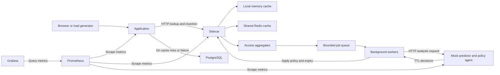

# Code explanation: how the application works end to end

This guide explains the code that is actually implemented in this folder. Read it alongside `demo guide.md`: that guide shows what to demonstrate; this one explains what happens underneath each demonstration.

The central idea is simple: **the application retrieves products now, and background workers use recent access patterns to adjust how long those products can stay cached.** A product request does not wait for the AI workflow. It does wait for cache lookup, any required database read, and a bounded cache insertion attempt.

The caching, HTTP services, Redis operations, queue, concurrency safeguards and monitoring are implemented. `MockLSTM` and `MockRL` are deterministic placeholders. There is no trained neural network, training loop or reinforcement-learning reward update in this prototype.

For a first reading, follow sections 1–10. Return to concurrency, monitoring and utilities afterward.

- [Processes and architecture](#1-first-understand-what-is-running)
- [Startup order](#3-startup-order-from-docker-to-listening-services)
- [One request, step by step](#5-first-request-follow-products1-through-every-layer)
- [Background jobs](#7-how-requests-become-background-jobs)
- [The mock AI calculation](#9-what-the-current-ai-actually-calculates)
- [Applying a TTL](#10-how-a-ttl-decision-changes-the-cache)
- [Concurrency](#12-concurrency-what-can-happen-at-the-same-time)
- [Dashboard metrics](#14-how-the-dashboards-connect-to-the-code)
- [Code-reading order](#18-recommended-code-reading-order)

## 1. First understand what is running

There is no single file that runs everything from top to bottom. Docker starts several processes. Each Go service has its own `main()` function, and HTTP requests connect them.

| Component | Entry point or configuration | Responsibility |
|---|---|---|
| Main application | `cmd/app/main.go` | Accept product requests; try the sidecar; read PostgreSQL when necessary. |
| Cache sidecar | `cmd/sidecar/main.go` | Own the local cache, Redis access, observations, queue and background workers. |
| Workflow service | `cmd/workflow/main.go` | Turn an analysis request into proposed TTL values. |
| PostgreSQL | `compose.yaml`, `migrations/001_products.sql` | Store the authoritative product records. |
| Redis | `compose.yaml`, accessed through `internal/system/redis.go` | Share cached product entries between sidecars. |
| Prometheus | `prometheus.yml` | Periodically collect numerical metrics from the Go services. |
| Grafana | `observability/grafana/` | Query Prometheus and display the dashboards. |

The sidecar is a separate HTTP service. Its local cache belongs to the **sidecar process**, not to the main application's memory.



There are three different flows in this diagram:

1. **Serving:** request → cache lookup → database if necessary → response.
2. **Adapting:** access observations → batch → worker → workflow → TTL policy.
3. **Observing:** service metrics → Prometheus → Grafana.

Grafana does not choose a TTL. Prometheus does not supply the workflow's training data. The sidecar constructs the workflow input directly from its own observations.

## 2. A small Go vocabulary for reading this project

| Syntax or concept | Meaning here |
|---|---|
| `struct` | A group of related fields, such as a cached `Entry`. |
| `func (c *Cache) Lookup(...)` | A method operating on a particular `Cache` instance. |
| `*Cache` | A pointer to an existing cache; methods share its state instead of copying the whole cache. |
| `interface` | Required methods. For example, `SharedCache` allows real Redis and a test implementation to be substituted. |
| `map[string]...` | Values indexed by a string, such as `product:1`. |
| `defer` | Run cleanup when the function returns, including error returns. |
| `go p.worker()` | Start a goroutine: a task that can run concurrently with request handlers. |
| `chan job` | A channel carrying jobs between producers and workers. A buffered channel can hold a limited number of waiting jobs. |
| `sync.Mutex` | A lock protecting shared state from simultaneous changes. |
| `context.Context` | Carries cancellation and deadlines through operations. It is not a cache or a background thread. |
| `sync.WaitGroup` | Tracks workers so shutdown can wait for them. |
| `json.RawMessage` | Already-encoded JSON. Product JSON can pass through the cache without becoming a quoted JSON string. |

Most HTTP handlers run concurrently. Code that looks sequential within one handler may run at the same time as another handler or a worker.

## 3. Startup order: from Docker to listening services

### 3.1 Docker builds and starts the processes

`Dockerfile` builds seven Go executables: `app`, `sidecar`, `workflow`, `data`, `load`, `validate` and `smoke`. The first three are the long-running application services; the others are utilities.

`compose.yaml` establishes dependencies:

- The sidecar starts after Redis is healthy and the workflow container has started.
- The app starts after PostgreSQL is healthy and the sidecar container has started.
- Grafana starts after Prometheus has started.

These are dependency relationships, not a guarantee that every service starts sequentially or that a started HTTP service is already healthy. The app does not require a healthy AI service to serve products.

On an empty PostgreSQL volume, `migrations/001_products.sql` creates the products table and 1,000 initial products. Existing database volumes retain their contents; restarting the app does not rerun initialization SQL.

### 3.2 Each service loads configuration

All three entry points call `LoadConfig` in `internal/system/config.go`, then create their dependencies and call `Serve` from `internal/system/http.go`.

Useful defaults, before environment overrides:

| Setting | Default | Meaning |
|---|---:|---|
| Mode | `adaptive` | Cache with background policy generation. |
| Default entry TTL | 60 seconds | Used when there is no valid policy for the key. |
| TTL bounds | 1–3,600 seconds | Allowed TTL decision range. |
| Maximum freshness age | 3,600 seconds | Upper bound on entry age measured from its fetch timestamp. |
| Local capacity | 1,000 entries | Maximum number of local cached values. |
| Policy capacity | 10,000 entries | Maximum number of cached policies. |
| Batch size | 100 accesses | Flush an endpoint's current aggregate at this count. |
| Flush interval | 5 seconds | Also flush nonempty aggregates periodically. |
| Queue capacity | 64 jobs | Maximum waiting analysis jobs. |
| Workers | 2 | Concurrent background analysis workers. |
| History size | 8 windows | Previous aggregates retained per endpoint. |
| Policy lifetime | 10 minutes | How long a stored TTL recommendation remains valid. |
| Cache timeout | 100 milliseconds | Deadline used for individual cache HTTP/Redis operations. |
| Database timeout | 2 seconds | Deadline for a product database fetch. |
| AI timeout | 2 seconds per attempt | Deadline for a workflow call. |
| AI retries | 2 | Up to three total attempts. |

`LoadConfig` validates modes, bounds, capacities and timeouts. These defaults are not a promise about the current running containers: Compose, shell environment variables and the smoke-test override can change them.

The Go code does not read `.env` itself. Docker Compose reads it for substitutions that are explicitly wired into `compose.yaml`. For example, this workspace's `APP_PORT=18080` exposes container port 8080 on host port 18080; it does not change the internal app address.

### 3.3 Main application's startup

```text
cmd/app/main.go: main
  → LoadConfig(":8080")
  → OpenPostgres(startup context, database URL)
      → create connection pool and ping PostgreSQL
  → NewMetrics()
  → NewApp(config, database, metrics)
  → App.Handler()
      → register GET /products/{id}, /metrics, /healthz, /readyz
  → Serve(...)
      → listen for HTTP requests
```

`NewApp` creates a process-level cancellation context and an HTTP client for sidecar requests. The app keeps a `singleflight.Group` for overlapping database fetches, explained in section 12.

### 3.4 Sidecar startup

```text
cmd/sidecar/main.go: main
  → LoadConfig(":8081")
  → NewRedis(config)
  → NewMetrics()
  → NewCache(config, Redis adapter, metrics)
  → NewPipeline(config, cache, metrics)
      → create endpoint buffers and bounded job channel
      → start worker goroutines
      → start timer/maintenance goroutine
  → Sidecar.Handler()
  → Serve(...)
```

The workers initially wait for jobs. The timer goroutine periodically flushes observations and removes expired local entries and policies.

### 3.5 Workflow startup

```text
cmd/workflow/main.go: main
  → LoadConfig(":8082")
  → construct Workflow with MockLSTM, MockRL and metrics
  → Workflow.Handler()
      → register POST /analyze and common monitoring routes
  → Serve(...)
```

The workflow runs the predictor and agent when it receives `/analyze`. They are ordinary Go method calls inside this service.

## 4. Understand the data before following a request

The HTTP contracts and shared types are in `internal/system/types.go`.

| Type or field | What it represents |
|---|---|
| `Product` | Database data: ID, name, payload, version and update time. |
| Cache key `product:1` | One particular cached object. |
| Endpoint `GET:/products/:id` | A group of requests. All product IDs share this endpoint's batching/history. |
| `Entry.Value` | Product response JSON stored in the cache. |
| `Entry.SourceVersion` | The database version captured by this fetch. |
| `Entry.FetchedAt` | When the fetch began; the reference point for freshness and expiry. |
| `Entry.ExpiresAt` | Absolute time after which this cached entry cannot be served. |
| `Policy.TTLSeconds` | A recommendation used to calculate an entry's expiry. |
| `Policy.UpdatedAt` / `ExpiresAt` | When the recommendation was stored and when the recommendation becomes invalid. |
| `Aggregate` | Counts, timing totals and per-key statistics for an observation window. |
| `FillObservation` | What a database fill revealed: version, fetch cost, size and possibly an estimated update interval. |
| `AnalysisRequest` | Current aggregate, previous windows, policies, observations, resource context and bounds. |
| `Decision` | One cache key and an integer TTL in seconds. |

Do not confuse these three kinds of version/identity:

- `Product.Version` / `Entry.SourceVersion` identify versions of **data**.
- `Sequence` / `JobID` identify ordered **analysis jobs** for an endpoint.
- `SchemaVersion` identifies the **JSON contract format**, currently 1.

Also distinguish entry expiry from policy expiry. A 36-second entry TTL and a 10-minute policy lifetime mean “each fill uses a 36-second lifetime while this recommendation remains valid.” They do not mean the product is cached for ten minutes.

## 5. First request: follow `/products/1` through every layer

Assume adaptive mode, a valid database row, and neither cache tier containing `product:1`.

### Step 1 — the app accepts the request

`App.Handler` routes `GET /products/1` to `App.product` in `internal/system/app.go`.

The handler starts request timing, parses the ID as a positive integer, and builds:

```text
cache key: product:1
endpoint:  GET:/products/:id
```

An invalid ID returns HTTP 400. A valid ID proceeds to cache lookup unless mode is `none`.

### Step 2 — the app asks the sidecar

`App.lookup` makes a bounded HTTP request to the sidecar:

```http
POST /cache/lookup
Content-Type: application/json

{"cacheKey":"product:1","endpoint":"GET:/products/:id"}
```

The `post` helper in `internal/system/http.go` handles JSON encoding, the request context, HTTP status checking and response decoding.

### Step 3 — the sidecar checks local memory, then Redis

The inline `/cache/lookup` handler registered by `Sidecar.Handler` in `internal/system/sidecar.go` validates the body, cache key and allowed endpoint, then calls `Cache.Lookup` in `internal/system/cache.go`. There is no separately named `Sidecar.lookup` method; look inside `Handler` for this code.

`Cache.Lookup` takes the cache mutex and tries:

1. Local LRU lookup. An existing unexpired entry returns immediately as a local hit.
2. Remove an expired local entry, if found.
3. Redis lookup through the `SharedCache` interface.
4. If Redis has an acceptable unexpired entry, copy it into local memory and return a Redis hit.
5. Otherwise return a miss, or an error if Redis failed.

Redis uses the physical key `entry:product:1`. The prefix is added by the adapter in `internal/system/redis.go`.

For our first request, both tiers are empty. The lookup result is a miss.

### Step 4 — record this access

Before replying to the app, that sidecar lookup handler calls `Pipeline.Record` with the lookup's key, endpoint, tier, hit/miss, timestamp and duration.

This is one access event. It updates metrics and, in adaptive mode, updates the endpoint's current aggregate. A valid lookup that encounters a Redis error still records an access. An invalid HTTP lookup request is rejected before reaching this step.

Recording and possibly enqueuing a batch happen before the lookup reply. The request does **not** wait for a worker to analyze that batch.

### Step 5 — the app fetches PostgreSQL

The app received a miss, so `App.product` calls its `singleflight.Group.Do` using `product:1` as the key.

Inside the shared fetch function:

1. Create a bounded operation context derived from the app's lifetime context.
2. Record `fetchedAt` immediately before the database fetch.
3. Call `Database.Product` with a database timeout.
4. Measure database duration and increment the database-read counter.
5. Marshal the returned product into JSON.

`Postgres.Product` in `internal/system/database.go` executes a parameterized query for `id`, `name`, `payload`, `version` and `updated_at`. It maps a missing row to `ErrNotFound`.

The `fetchedAt` timestamp is deliberately conservative: time spent fetching the record already counts toward the cached entry's lifetime. Database-read metrics count attempts, including failed reads.

### Step 6 — the app sends the fetched value back to the sidecar

The app calls `POST /cache/insert` with a `FillRequest` containing the key, endpoint, product JSON, source version, fetch timestamp and measured database duration.

The inline `/cache/insert` handler in `Sidecar.Handler` validates the input and calls `Cache.Fill` under a cache timeout.

`Cache.Fill`:

1. Finds an unexpired policy for the key, or uses the default TTL.
2. Calculates absolute expiry from the original `FetchedAt`.
3. Rejects an already-expired fill or one older than a newer local version.
4. Writes the entry to Redis using the version-checking Lua script.
5. Inserts it into the local LRU only after the Redis write succeeds.

The sidecar also calls `Pipeline.Fill` to record the fill outcome and metadata. **A fill is not another access**, so one miss followed by one insertion does not count as two product requests.

### Step 7 — return the product

The app returns the product JSON with:

```http
X-Cache-Tier: database
```

The app waits for the insertion attempt, but an insertion failure does not discard a successful database result. The product can still return HTTP 200, and a later request may need another database fetch.

```mermaid
sequenceDiagram
    participant C as Client
    participant A as App
    participant S as Sidecar
    participant R as Redis
    participant D as PostgreSQL
    C->>A: GET /products/1
    A->>S: POST /cache/lookup
    Note over S: Local miss
    S->>R: GET entry:product:1
    R-->>S: Missing
    Note over S: Record one access; possibly enqueue analysis
    S-->>A: Cache miss
    A->>D: SELECT product 1
    D-->>A: Product and version
    A->>S: POST /cache/insert
    S->>R: Version-checked write with absolute expiry
    Note over S: Store local entry; record fill observation
    S-->>A: Insertion result
    A-->>C: Product JSON; tier database
```

## 6. Second request, Redis hits and expiry

### A local hit

The next request repeats the app → sidecar lookup. If the local entry is still valid, `Cache.Lookup` returns it immediately without reading Redis or PostgreSQL. The app returns its value with `X-Cache-Tier: local`.

The sidecar still records the access. Cached requests therefore continue supplying the observations needed for adaptation.

### A Redis hit

If the local entry was evicted or the sidecar restarted, Redis may still hold it. `Cache.Lookup` retrieves it, checks expiry and maximum age, and copies it into the local LRU. The app returns `X-Cache-Tier: redis`.

This promotion preserves `FetchedAt` and `ExpiresAt`. Reading a popular object repeatedly does not restart its freshness clock.

### An expired entry

Lookup rejects expired local/Redis data. Redis also expires its key using an absolute timestamp. A maintenance tick removes expired local entries and expired policies approximately once per second; lookup checks prevent serving an expired entry between maintenance ticks.

When no usable cached copy remains, the next request fetches PostgreSQL and fills both tiers again.

### What LRU contributes

`internal/system/lru.go` uses a map for key lookup and a linked list for recency order. Reads move entries to the front; capacity pressure removes the least recently used entry from the back.

LRU controls **which entries fit in memory**. TTL controls **how long entries are valid**. Either can remove an entry. The generic LRU itself has no expiry logic or mutex; its owning cache/pipeline supplies those protections.

## 7. How requests become background jobs

Follow `internal/system/pipeline.go` in this order:

```text
Record → flushLocked → queue → worker → process → apply
```

### 7.1 `Record`: accumulate a window of observations

The pipeline has one `endpointBuffer` for each configured endpoint. For product requests, it tracks one buffer for `GET:/products/:id`, containing per-key counters.

For example, three accesses might produce:

```text
Endpoint: GET:/products/:id
Total requests: 3
Hits: 1, misses: 2
product:1 → accesses 2, hits 1, misses 1
product:2 → accesses 1, hits 0, misses 1
```

`Record` also accumulates lookup duration and local/Redis hit counts. It holds `Pipeline.mu` while changing shared aggregates.

### 7.2 `flushLocked`: turn a window into a job

A flush occurs when the batch-size threshold is reached or the flush timer sees a nonempty aggregate. Shutdown also attempts a final flush.

The function:

1. Finishes the current window and calculates requests per second.
2. Increments the endpoint's sequence number.
3. Copies relevant fill observations for keys in this window.
4. Constructs an `AnalysisRequest` with the current window and previous history.
5. Adds the finished window to bounded history, retaining the newest eight by default.
6. Replaces the active aggregate with a new empty one.
7. Attempts to enqueue the job without waiting for channel capacity.

The job's history contains **previous windows**. Its current window is a separate field. Empty windows are not added to history, and even a window whose job is dropped still becomes historical observation data.

The current aggregate's map becomes part of the snapshot and is no longer mutated. Subsequent requests write to a new map, so workers do not read an aggregate that handlers are actively changing.

### 7.3 A full queue drops analysis work

The essential code is:

```go
select {
case p.queue <- j:
    // Job accepted.
default:
    // Queue is full: count the dropped batch.
}
```

This prevents a saturated inference queue from making a product request wait for queue space. Existing cache entries and policies continue operating when a batch is dropped.

It does not make the whole request path wait-free: aggregation uses a mutex, and cache operations use another mutex and can perform Redis I/O.

### 7.4 Fill observations are separate

`Pipeline.Fill` stores a bounded set of recent fill observations per endpoint. If a later fill has a higher source version, it can estimate:

```text
observed update interval
  = time between observed fills / increase in source version
```

For example, a version increase of 2 over 16 seconds gives an estimated interval of 8 seconds. This is a sampled estimate from fills, not a record of every database update. The first observation has an unknown interval, represented by a nil pointer and JSON `null`.

A batch may flush before the database fill for its last miss arrives. That batch can legitimately lack that fill observation. A subsequent same-version observation can also have an unknown interval; the code does not maintain a permanent learned update rate.

## 8. What a worker sends to the workflow

Each `worker` receives jobs from the channel and calls `process`. With two workers, two analysis requests can be in progress concurrently.

`process` adds information collected at processing time:

- The current valid policies for the keys in the job.
- Local entry count and capacity.
- Waiting queue depth.
- Go heap allocation size.

Redis memory and CPU utilization are currently unknown fields, encoded as `null`. The aggregate/history/observations were captured at flush time; policies and resource values are captured later. They are not one perfectly simultaneous snapshot of the system.

The worker sends the resulting `AnalysisRequest` to `POST /analyze`. A default failure can trigger up to three HTTP attempts, with 50 ms and 100 ms backoff between them. Each attempt has an AI timeout. These retries happen in the worker, outside the product request path.

Transport/status/decoding failures are retried. A successfully decoded response that later fails policy validation in `apply` is rejected without another workflow call for that job.

## 9. What the current “AI” actually calculates

The implementation is in `internal/system/workflow.go`:

```text
Workflow.analyze
  → decode and validate AnalysisRequest
  → optional simulated latency/failure
  → MockLSTM.Predict
  → MockRL.Decide
  → return AnalysisResponse
```

### 9.1 `MockLSTM.Predict`: estimate per-key demand

For each key in the current window:

```text
current rate = key accesses / current window duration

historical rate = weighted average of that key's rates in older windows
                 with weights 1, 2, 3, ... from oldest to newest

predicted reuse = current rate                         if there is no history
predicted reuse = 0.5 × current rate + 0.5 × historical rate otherwise
```

Durations are floored at 0.001 seconds to avoid division by zero or extremely small denominators. A key absent from a historical window contributes zero accesses for that window. Predictions are sorted by key for deterministic output.

Despite the name `MockLSTM`, this is arithmetic, not an LSTM network. The source comment says “exponentially weighted,” but the implemented weights are **linear** (`i + 1`). The calculation above describes the executable code.

### 9.2 `MockRL.Decide`: convert demand to TTL

For fewer than two historical windows, the agent returns the configured default TTL.

With at least two historical windows, it computes:

```text
candidate TTL = minimum TTL + integer(15 × ln(1 + predicted reuse))
```

If an observed update interval is available, it caps this candidate at half that interval, converted to integer seconds. Finally, it clamps the result to the allowed minimum/maximum TTL bounds.

This gives a simple rule: more demand tends to increase TTL; evidence of frequent updates can shorten it. There is no reward optimization or training in `MockRL`.

### 9.3 A worked example

Assume the minimum TTL is 1 second, the default is 60 seconds, and the current window plus two historical windows each show 10 accesses per second for `product:1`.

```text
historical rate = (1 × 10 + 2 × 10) / (1 + 2) = 10
predicted reuse = 0.5 × 10 + 0.5 × 10 = 10
candidate TTL  = 1 + integer(15 × ln(11))
               = 1 + 35
               = 36 seconds
```

If the same request includes an observed update interval of 8 seconds:

```text
update-based cap = integer(8 / 2) = 4 seconds
final TTL       = 4 seconds
```

Without that observation, it stays 36 seconds. During the first two windows, the default remains 60 seconds because there are not yet two previous windows.

The history requirement is per endpoint. It does not require two prior windows containing nonzero accesses for every individual key.

Although policies, hit/miss context and resource values are included in the analysis contract, the present mock rule uses demand and the optional update interval. Sending a field does not mean the mock uses it to make a decision.

## 10. How a TTL decision changes the cache

### 10.1 Validate the response first

`Pipeline.apply` calls `validateDecisions` before changing any key. It checks:

- Schema version and matching job ID.
- A nonempty decision list.
- Every decision key belongs to the current request's aggregate.
- No duplicate keys.
- Every TTL is within the configured bounds.

TTL fields are Go integers, so JSON decoding rejects fractional values such as `1.5`. Unknown JSON fields, oversized request bodies and trailing JSON content are also rejected by the HTTP helpers where those helpers are used.

A response may contain a valid subset of the requested keys; the validator does not require a decision for every key.

### 10.2 Reject old job results

Multiple workers may finish out of order. Suppose job 8 takes longer than job 9. After job 9 is accepted for an endpoint, job 8 must not overwrite it.

`Pipeline.apply` checks the job sequence against `p.applied[endpoint]`. A sequence less than or equal to the stored one is rejected. `applyMu` serializes the application step; this is one global mutex, so policy application across endpoints is also serialized.

### 10.3 Store the policy and adjust existing entries

For each accepted decision, `Cache.Apply`:

1. Reads the current Redis entry, if any.
2. Calculates a new absolute expiry using that entry's original fetch time.
3. Attempts an atomic compare-and-update of Redis expiry and stored JSON.
4. Stores the new local policy with its own policy lifetime.
5. Adjusts any existing local entry's expiry from that local entry's original fetch time.
6. Removes the local entry if the new expiry is already in the past.
7. Updates policy metrics.

This does not read PostgreSQL or fetch a new product. If the Redis value has disappeared, applying a policy does not recreate it. The recommendation can still be saved for a future fill.

### 10.4 Expiry is anchored to the fetch, not the decision

The calculation is:

```text
entry expiry = fetchedAt + min(chosen TTL, maximum freshness age)
```

Example:

```text
12:00:00  Product fetched; initial TTL 60s → expiry 12:01:00
12:00:10  Policy chooses TTL 36s          → expiry 12:00:36
```

The new expiry is not 12:00:46. Ten seconds of the entry's lifetime have already passed.

If the decision at 12:00:10 chooses 4 seconds, the entry is already too old and is evicted. The next product request fetches the database and uses the stored 4-second policy for its new entry.

Reading an entry does not extend it. A later accepted policy may extend an existing entry's expiry, but still relative to its original fetch and within the maximum freshness-age bound.

### 10.5 Applying a batch is not a database transaction

All decisions are validated before application, but Redis writes happen one key at a time. If a later key fails, earlier keys may already have changed. The accepted sequence is recorded before those writes and is not rolled back on a partial failure.

The guarantee is validation plus ordered application attempts, not atomic all-or-nothing updates across an entire batch.

## 11. Why the Redis Lua scripts exist

`internal/system/redis.go` contains two small scripts executed atomically by Redis. They keep a check and its dependent write together, so another client cannot change the key between them.

### `putLua`: reject an older fill

Consider two overlapping database operations:

```text
Fetch A gets version 7 but is delayed.
Fetch B gets version 8 and writes the cache first.
Fetch A finally tries to insert version 7.
```

The script checks the existing source version and rejects A's older fill. It also checks the expiry against Redis server time before writing with `PXAT`, Redis's absolute expiry in milliseconds.

The local cache also checks for a newer local version. Equal versions are permitted; the guarantee is specifically against overwriting a higher version with a lower one.

### `expiryLua`: do not rewrite an entry that changed meanwhile

For a policy update:

```text
Worker reads the serialized Redis entry for version 7.
A concurrent fill replaces it with version 8.
Worker tries to change expiry using the version-7 snapshot.
```

The script compares the entire current serialized value with the worker's expected value. If they differ, it skips the write. This is compare-and-swap (CAS).

In this implementation, a CAS mismatch is not reported as a Go error. The newer Redis entry is left untouched; the local policy is still stored and any local entry is handled separately. A policy can therefore take effect on a future fill even if that particular Redis expiry update was skipped.

Lua JSON numbers use floating-point representation. This prototype assumes source version counters remain safely below `2^53`, where integer precision would become a concern.

## 12. Concurrency: what can happen at the same time?

### Singleflight combines overlapping database fetches

If 20 app requests miss for `product:1` at approximately the same time, each performs its own sidecar lookup and records its own access. Their overlapping `group.Do("product:1", ...)` calls share one database fetch and one fill attempt inside that app instance.

All successful waiters receive the shared database result and report the database tier. Singleflight is not another result cache, and the shared function does not perform a second cache lookup before querying PostgreSQL. Requests that arrive outside the overlap can start another fetch.

Singleflight is local to one app process. `app` and `app2` do not share a distributed lock.

### Cancellation does not belong to the first caller alone

The shared database/fill operation uses the app's lifetime context plus bounded timeouts, not the initiating request's context. If that caller disconnects, other callers can still receive the shared result.

`Group.Do` itself waits for the shared function. After it returns, the handler checks its own request context before writing a response. Therefore an individual canceled waiter is not immediately removed from the wait by this implementation.

### Locks and ownership

| State | Owner/protection | Why it matters |
|---|---|---|
| Local entries and policies | `Cache.mu` | Prevent concurrent LRU/map mutation. |
| Endpoint aggregates, history, fill observations and queued timestamps | `Pipeline.mu` | Keep observation snapshots and queue bookkeeping consistent. |
| Accepted job sequences and policy application | `Pipeline.applyMu` | Reject older results and serialize application. |
| Waiting jobs | Buffered Go channel | Bound waiting work and connect producers to workers. |
| Cached Redis values | Atomic Redis operations and Lua scripts | Protect against interleaving between clients/sidecars. |

`Cache.mu` is held during Redis operations. A slow Redis call can therefore hold up other cache operations waiting for that mutex. A context deadline bounds supported network operations, but it does not make ordinary Go mutex acquisition cancellable.

The important separation is that slow inference does not hold the request path waiting for an AI result. The system still has normal HTTP, Redis and lock contention costs.

### Where state lives and what a restart loses

| State | Location | Restart behavior |
|---|---|---|
| Authoritative products | PostgreSQL volume | Preserved by ordinary container restart/recreation with the volume retained. |
| Shared cache entries | Redis memory | Can survive a sidecar restart; Redis persistence is disabled in this Compose setup. |
| Local entries and policies | Each sidecar's RAM | Lost when that sidecar restarts. |
| Aggregates, history, observations and pending jobs | Each sidecar's RAM | Lost on restart; there is no durable job queue. |
| Singleflight coordination | Each app's RAM | Only coordinates currently overlapping work in that app. |

In the optional multi-instance setup, sidecars share Redis values but have separate local entries, policies, history and job sequences. There is no global ordering of decisions between sidecars, and invalidating one sidecar does not clear another sidecar's local cache.

## 13. Failures, freshness and shutdown

### What happens when something fails?

| Situation | Behavior in the code |
|---|---|
| Sidecar lookup fails or times out | App counts the error and tries PostgreSQL. |
| Redis fails during lookup | Sidecar records the access and returns an error; app falls back to PostgreSQL. |
| Cache insertion fails | A successful database response can still be returned to the user. |
| Product does not exist | App returns HTTP 404. |
| Database fetch fails | App returns HTTP 503. |
| Workflow is slow/unavailable | Workers retry within their configured limits; product serving continues using available cache policies/defaults. |
| Workflow returns invalid decisions | Reject the response and count failure; do not apply that invalid decision list. |
| Analysis queue is full | Drop the new batch; retain normal serving behavior and existing policies. |
| Policy expires or is capacity-evicted | Future fills fall back to the default TTL until another policy is available. Existing entry expiry is not automatically recomputed just because its policy expired. |

`/healthz` indicates the HTTP process is serving. App `/readyz` pings PostgreSQL; sidecar `/readyz` pings Redis. The workflow's readiness callback has no external dependency check. Readiness does not certify that every background analysis succeeds.

### TTL does not detect every database change immediately

The demo updater changes PostgreSQL versions and timestamps independently. It does not automatically invalidate cached entries. A cached version can therefore be older than the latest database version until expiry or explicit invalidation.

The maximum freshness setting limits age since fetch. It is not a guarantee that a cached value always equals the latest committed database value.

`POST /cache/invalidate` removes the addressed sidecar's local entry and the Redis entry. It leaves the key's policy intact and does not broadcast invalidation to other sidecars.

### Shutdown order

`Serve` in `internal/system/http.go` listens for an interrupt or termination signal and starts HTTP server shutdown with the configured shutdown timeout.

The component cleanup then runs:

- **App:** cancel the app lifetime context and close the PostgreSQL pool.
- **Sidecar:** stop the timer loop, attempt a final flush, mark the pipeline closed, close the job channel and wait for workers; then close Redis.
- **Workflow:** finish HTTP shutdown; there is no separate background pipeline to drain.

If the sidecar's shutdown context expires, the pipeline cancels its worker context. Workers skip queued jobs after cancellation and finish draining the channel. The final flush can still be dropped when the queue is full. Cleanup is cooperative, so the timeout should not be interpreted as a hard upper bound on every mutex wait and cleanup action.

## 14. How the dashboards connect to the code

`internal/system/metrics.go` creates a separate Prometheus registry in each Go process. `/metrics` exposes it as text. `prometheus.yml` scrapes app, sidecar and workflow every five seconds. Prometheus adds labels such as `instance` to distinguish their samples.

Grafana's datasource is provisioned by `observability/grafana/provisioning/datasources/prometheus.yaml`. Dashboard JSON lives in `observability/grafana/dashboards/`.

| Dashboard observation | Metric | Code that produces it |
|---|---|---|
| Request throughput and latency | `app_request_seconds` histogram | Deferred timing in `App.product`. |
| Database reads | `cache_events_total{kind="database_read"}` | Shared database fetch in `App.product`. |
| Database latency | `database_read_seconds` histogram | Timing around `Database.Product`. |
| Cache accesses and tier distribution | `cache_events_total{kind="access"}`, `cache_lookup_seconds` histogram | `Pipeline.Record`; histogram `outcome` identifies local, Redis or miss tier. |
| Created/dropped batches | `cache_events_total` with `batch_created` / `batch_dropped` | `flushLocked`. |
| Queue depth and oldest waiting job | `cache_state` with `queue_depth` / `oldest_queued_job_age_seconds` | Pipeline queue bookkeeping and maintenance. |
| Calls reaching the workflow | `cache_events_total{kind="workflow_call"}` | `Workflow.analyze` after request validation. |
| Analysis processing duration | `ai_processing_seconds` histogram | `Pipeline.process`, including its workflow attempts, backoff and policy application. |
| Analysis failures | `cache_events_total{kind="ai_failure"}` | Failed processing in `Pipeline.process`. |
| Policy applications | `cache_events_total{kind="policy_update"}` | Successful `Cache.Apply` per key. |
| Local/policy entry counts and policy age | `cache_state` | `Cache.Maintain` and policy application. |

Open the [request-path dashboard](http://localhost:13000/d/cache-request-path) to connect traffic, hits and database work. Open the [background dashboard](http://localhost:13000/d/cache-background) to connect batches, queue activity, workflow calls and policy application.

Interpret these carefully:

- A policy-update counter increments for an application even when the TTL number did not change.
- AI processing duration is worker processing time, not pure model compute time and not queue waiting time.
- Lookup histogram counts can be used to count hits by tier; the metric family contains both duration buckets and observation counts.
- Metrics use bounded labels, not individual product IDs. There is no per-product TTL plot in the current instrumentation.
- Grafana does not directly measure cached-versus-database version staleness. The benchmark validator does a separate comparison.
- An empty graph or undefined percentile with no observations does not mean measured latency is zero. Scraping and dashboard refresh also introduce display delay.

## 15. Modes: which parts run in each experiment?

| Mode | App uses sidecar? | Cache TTL behavior | Background aggregation/inference? |
|---|---|---|---|
| `none` | No | No application cache lookup/fill | No request-driven analysis from the app. |
| `fixed` | Yes | Default TTL, without adaptive policy generation | Lookup metrics still recorded; adaptive aggregates are skipped. |
| `adaptive` | Yes | Default initially, then accepted policies | Yes: aggregate, queue, analyze and apply. |

The same-mode environment is passed to app and sidecar by Compose. Containers may exist even when a particular mode does not use their functionality.

Changing modes is not itself a clean experimental reset. Existing Redis data and earlier metric samples can remain; the benchmark script performs additional setup for its runs.

## 16. The other executables: generating and checking a demo

### `cmd/data/main.go`: create or update source data

The data utility seeds products or performs database updates. Updates increment `version` and change `updated_at`. Seeding existing keys also increments their versions. These changes happen in PostgreSQL; they are not automatic cache invalidations.

### `cmd/load/main.go`: generate scheduled traffic

The load generator schedules requests at the requested rate, uses a bounded worker queue and records results. If its work queue is full, it counts dropped scheduled requests rather than accumulating unlimited pending HTTP work.

`internal/bench/bench.go` supplies seeded key selection, HTTP measurement, percentile calculation, metrics snapshots and freshness validation. Scenarios can favor hot keys, scan unique keys, change the hot region or create a burst. A seeded key sequence is reproducible; OS scheduling and network timings are not bit-for-bit reproducible.

When updates are enabled, an independent goroutine changes database rows while requests run. HTTP results include status, tier and source version. JSON summaries and JSONL samples provide evidence separate from Grafana.

Important details:

- HTTP sample timing ends after reading the response body, before decoding product JSON.
- The payload flag describes the expected dataset; database payload size is established by seeding.
- Pending work is bounded, but collected samples are retained in memory for the run. An extremely long load run can therefore use growing memory.
- Benchmark percentiles are calculated from samples; Grafana histogram estimates use buckets and need not match exactly.

### `cmd/validate/main.go`: assess recorded freshness

The validator reads recorded samples and compares their versions with PostgreSQL. `bench.Validate` classifies successful samples:

| Comparison at validation time | Classification |
|---|---|
| Current database version equals served version | Fresh. |
| Database version is newer and its current update time is at or before request start | Provably stale: that version already existed when the request started. |
| Database version is newer but its current update time is later than request start | Indeterminate: this later update does not prove what existed at request time. |

Validation happens after the requests, so it cannot recover all historical versions from the current row. Its stale rate is `provably stale / (fresh + provably stale)`, excluding indeterminate samples; if nothing is classifiable, the rate is unknown.

Validation makes its own direct database reads. These are reported separately and do not increment the app's database-read metric. This prevents verification work from being mistaken for application cache misses.

### `cmd/smoke/main.go` and the scripts

The smoke executable checks that a cold request can reach the database, subsequent requests can hit cache, background policies can be applied, and expiry leads back to a database fetch. It also supports an AI-failure check.

`scripts/smoke.ps1` uses short TTLs/timeouts from `compose.smoke.yaml` to make these transitions quick. `scripts/benchmark.ps1` runs mode comparisons with cache/data setup between runs. Read the scripts before treating their operations as harmless inspection: benchmark setup intentionally clears the prototype Redis cache and reseeds data.

## 17. Which tests support the important behavior?

The behavioral tests are in `internal/system/system_test.go` and `internal/bench/bench_test.go`. Examples worth reading after the implementation:

| Behavior | Test |
|---|---|
| Local/Redis tiers and expiry changes | `TestCacheTiersPoliciesAndExpiry` |
| Policy CAS preserves a concurrent fill | `TestPolicyCASDoesNotOverwriteConcurrentFill` |
| Concurrent local fill and policy operations | `TestConcurrentLocalFillAndPolicy` |
| Count/timer batching and history | `TestBatchCountsSizeTimerAndHistory` |
| Saturated queue and shutdown | `TestQueueSaturationAndShutdown` |
| Old or malformed decisions are rejected | `TestOutOfOrderAndMalformedDecisions` |
| Sidecar failure and shared database fetches | `TestAppSidecarFailureAndSingleflight` |
| Slow inference stays outside the request path | `TestInferenceDoesNotHoldRequestPath` |
| Real Redis behavior | `TestRedisIntegration` |
| Full flow with real Redis/PostgreSQL | `TestEndToEndRealDependencies` |
| Later database updates are not automatically called stale | `TestFreshnessDoesNotMisclassifyLaterUpdates` |

Unit tests use substitutes for dependencies where appropriate. Integration tests require their configured database/Redis environment variables and otherwise skip. The existing `VERIFICATION.md` records previously executed checks; creating this explanation does not constitute a new test run.

## 18. Recommended code-reading order

Read one complete request first, then the background flow. Do not start by reading every utility or dashboard JSON file.

| Order | File and functions | Question to answer while reading |
|---:|---|---|
| 1 | [internal/system/types.go](<E:/SLIIT/Y4 S1/IT4010 - Research/AI Adaptive Caching/internal/system/types.go>) | What data crosses each boundary? |
| 2 | [cmd/app/main.go](<E:/SLIIT/Y4 S1/IT4010 - Research/AI Adaptive Caching/cmd/app/main.go>), [cmd/sidecar/main.go](<E:/SLIIT/Y4 S1/IT4010 - Research/AI Adaptive Caching/cmd/sidecar/main.go>), [cmd/workflow/main.go](<E:/SLIIT/Y4 S1/IT4010 - Research/AI Adaptive Caching/cmd/workflow/main.go>) | Which objects does each process create? |
| 3 | [internal/system/config.go](<E:/SLIIT/Y4 S1/IT4010 - Research/AI Adaptive Caching/internal/system/config.go>): `LoadConfig` | Where do defaults and timeouts come from? |
| 4 | [internal/system/app.go](<E:/SLIIT/Y4 S1/IT4010 - Research/AI Adaptive Caching/internal/system/app.go>): `Handler`, `product`, `lookup` | When does a request use cache, database and singleflight? |
| 5 | [internal/system/sidecar.go](<E:/SLIIT/Y4 S1/IT4010 - Research/AI Adaptive Caching/internal/system/sidecar.go>): lookup and insertion handlers | What is validated and what is recorded? |
| 6 | [internal/system/cache.go](<E:/SLIIT/Y4 S1/IT4010 - Research/AI Adaptive Caching/internal/system/cache.go>): `Lookup`, `Fill` | Where does a value live and how is its initial expiry chosen? |
| 7 | [internal/system/database.go](<E:/SLIIT/Y4 S1/IT4010 - Research/AI Adaptive Caching/internal/system/database.go>), `redis.go`, `lru.go` | How do storage and local eviction actually work? |
| 8 | [internal/system/pipeline.go](<E:/SLIIT/Y4 S1/IT4010 - Research/AI Adaptive Caching/internal/system/pipeline.go>): `Record`, `Fill`, `flushLocked` | How do observations become immutable jobs? |
| 9 | [internal/system/pipeline.go](<E:/SLIIT/Y4 S1/IT4010 - Research/AI Adaptive Caching/internal/system/pipeline.go>): `worker`, `process` | What runs asynchronously and what gets retried? |
| 10 | [internal/system/workflow.go](<E:/SLIIT/Y4 S1/IT4010 - Research/AI Adaptive Caching/internal/system/workflow.go>): `Predict`, `Decide` | Which exact arithmetic produces a TTL? |
| 11 | [internal/system/pipeline.go](<E:/SLIIT/Y4 S1/IT4010 - Research/AI Adaptive Caching/internal/system/pipeline.go>): `apply`; `cache.go`: `Apply`; `redis.go`: `CompareExpiry` | How does a proposed TTL safely affect existing data? |
| 12 | [internal/system/http.go](<E:/SLIIT/Y4 S1/IT4010 - Research/AI Adaptive Caching/internal/system/http.go>): `Serve`; `pipeline.go`: `Close` | How are cancellation and shutdown handled? |
| 13 | [internal/system/metrics.go](<E:/SLIIT/Y4 S1/IT4010 - Research/AI Adaptive Caching/internal/system/metrics.go>), [prometheus.yml](<E:/SLIIT/Y4 S1/IT4010 - Research/AI Adaptive Caching/prometheus.yml>), dashboard JSON | Which function explains each dashboard change? |
| 14 | Tests, then `cmd/load` and `internal/bench` | How are the behavior and experimental results checked? |

Useful debugger breakpoint locations follow the same sequence: `App.product`, `Cache.Lookup`, `Postgres.Product`, `Cache.Fill`, `Pipeline.flushLocked`, `Pipeline.process`, `MockRL.Decide`, `Pipeline.apply` and `Cache.Apply`. Breaking on a worker can pause or disturb timing, so use breakpoints to understand control flow rather than to measure performance.

## 19. One complete story to rehearse in your own words

1. A client requests product 1. The app asks its sidecar for `product:1`.
2. The sidecar checks local memory and Redis, records one access and returns a miss.
3. The app fetches PostgreSQL, then attempts to store the product with version and absolute expiry in both cache tiers.
4. Later requests reuse that product while it remains valid. Every lookup still contributes an access observation.
5. At a count threshold or timer tick, the sidecar snapshots those observations into a bounded background queue.
6. A worker adds current policy/resource context and calls the workflow.
7. The mock predictor estimates demand; the mock agent turns it into a bounded TTL.
8. The sidecar validates the response, rejects obsolete jobs and applies the decision using the original fetch timestamp.
9. Atomic Redis checks protect newer data from older fills or stale expiry updates.
10. On expiry, the next request fetches the database again and uses the latest valid policy for its new entry.
11. Metrics emitted during these operations are scraped by Prometheus and displayed by Grafana.

If replacing the mock with a real model later, start with the `Predictor` and `PolicyAgent` interfaces in `workflow.go`. The surrounding application already supplies a structured analysis request and validates the resulting decisions, but a real model would still need its own training, evaluation, persistence and cancellation behavior.


---

# Appendix: directory-by-directory codebase walkthrough

Added on 16 October 2026. The earlier explanation above is preserved. This appendix starts with the physical folder/file layout, then explains execution after the file tour.

## A. How to follow this directory tour

This uses a `dir /s`-style approach: inspect the files in the root, then enter each subdirectory and explain its files before continuing to the next directory. Files and child directories are arranged by name for a predictable reading order. This is a reading order, not the order in which Go executes files.

The workspace root is `E:\SLIIT\Y4 S1\IT4010 - Research\AI Adaptive Caching`. All short paths below are relative to that root. Section B explains root files, and sections C–L follow the subdirectories. Section M then connects them in execution order.

Downloaded third-party code inside `.tools` and `.cache` is described by purpose rather than listing thousands of SDK/dependency files. Generated logs and results are identified separately from the source that creates them.

```text
AI Adaptive Caching/
  .dockerignore
  .env
  .env.example
  .gitignore
  benchmark-matrix.log
  benchmark-updates.log
  code explanation.md
  compose.smoke.yaml
  compose.yaml
  demo guide.md
  demo-*.log
  Dockerfile
  go.mod
  go.sum
  Makefile
  prometheus.yml
  README.md
  smoke-*.log
  verification-*.log
  VERIFICATION.md
  .cache/
    gobuild/
    gomod/
  .tools/
    go/
  cmd/
    app/main.go
    data/main.go
    load/main.go
    sidecar/main.go
    smoke/main.go
    validate/main.go
    workflow/main.go
  evidence/
  examples/
    analyze.json
  internal/
    bench/
      bench.go
      bench_test.go
    system/
      app.go
      cache.go
      config.go
      database.go
      http.go
      lru.go
      metrics.go
      pipeline.go
      redis.go
      sidecar.go
      system_test.go
      types.go
      workflow.go
  migrations/
    001_products.sql
  observability/
    grafana/
      dashboards/
        background-ai.json
        request-path.json
      provisioning/
        dashboards/prototype.yaml
        datasources/prometheus.yaml
  Pseudocode/
    main service/service.js
    sidecar/
      0 DEFAULT_POLICY.js
      0 policyStore.js
      1 routes.js
      2 service.js
      3 MetricsCollector .js
      4 AnalysisQueue.js
      5 analysisWorker.js
      6 runAIWorkflow.js
      7 applyDecision.js
      8 validation.js
  results/
  scripts/
    benchmark.ps1
    smoke.ps1
```

Two Go conventions make this layout easier to understand. A directory under `cmd` contains a separate executable with `package main` and a `main()` entry point. Files under `internal/system` all belong to one `system` package; they can use each other's types and functions without making HTTP calls. HTTP is needed when crossing between the separately running app, sidecar and workflow processes.

## B. Files in the root directory

### `.dockerignore`

Controls which files Docker excludes from its build context. It excludes `.tools`, `.cache`, `.git`, `results`, `bin`, `Pseudocode` and log files. This keeps SDK downloads, generated output and the original design sketches out of the build context. It does not control which files Git tracks.

### `.env`

Contains local values Docker Compose can substitute into `compose.yaml`, such as the host port used to reach the app. It is local configuration, not Go source. `LoadConfig` reads environment variables inside each process; it does not open this file. Compose must explicitly pass a setting into a container for that process to receive it.

### `.env.example`

Shows the available Compose substitutions and their example values: mode, host ports, TTL bounds, batch size, flush interval, cache/AI deadlines, retry count, artificial AI latency/failure, queue capacity and workers. Use it as a configuration reference. Some additional settings supported by `config.go` are not exposed by the current Compose environment blocks.

### `.gitignore`

Marks local/generated paths such as `.tools`, `.cache`, `bin`, `results`, `.env`, executables and logs as untracked by default if the folder is used with Git. This concerns version-control bookkeeping; it does not prevent the application from reading a file or Docker from using it.

### `benchmark-matrix.log` and `benchmark-updates.log`

Saved console output from earlier benchmark runs. They help explain what commands completed or failed during those runs. They do not schedule benchmarks and are not imported by the app. Numerical experiment summaries live under `results` and selected copies under `evidence`.

### `code explanation.md`

This document. The original portion explains concepts by execution flow. This appended portion explains the physical files first and execution afterward. Neither part is application input.

### `compose.smoke.yaml`

A small override to combine with `compose.yaml` for a quick smoke test. It changes sidecar settings to a 2-second default TTL, a 3-second maximum TTL/freshness age, batches of 4, a 250 ms flush interval, a 200 ms AI timeout and no retries. Those short intervals make a test observe caching, adaptation and expiry quickly. It is not the complete service definition and does not change the Go defaults.

### `compose.yaml`

Describes how the services run together. Each service block specifies its image, environment, ports, dependencies and volumes.

| Block | What its contents do |
|---|---|
| `postgres` | Starts PostgreSQL, creates the demo database/user, persists data in `pgdata`, and mounts initialization SQL. A health check waits for PostgreSQL readiness. |
| `redis` | Starts shared cache storage with a 128 MB limit and `allkeys-lru` eviction. Snapshot and append-only persistence are disabled. |
| `workflow` | Runs the `/workflow` executable and passes optional simulated AI latency/failure settings. |
| `sidecar` | Runs `/sidecar`, points it at Redis and the workflow, and passes cache/batch/worker settings. |
| `app` | Runs `/app`, points it at PostgreSQL and the sidecar, and maps the configured host port to container port 8080. |
| `app2`, `sidecar2` | Optional `multi` profile. A second app/sidecar pair shares Redis and PostgreSQL but keeps its own in-memory state. |
| `prometheus` | Mounts `prometheus.yml` and exposes the metrics query server. |
| `grafana` | Mounts datasource/dashboard provisioning, persists Grafana data, and exposes its UI on localhost. |
| `tools` | A one-off utility container, defaulting to `/data`. Commands can override its entry point to `/load`, `/validate` or `/smoke`. Mounts `results` for output. |
| `verify` | A test-profile Go container that runs `go vet` and race-enabled tests against the real Redis/PostgreSQL services. |
| `volumes` | Declares PostgreSQL, Grafana and Go test cache volumes. |

The YAML anchors `&app-env` and `&sidecar-env` allow the second instance to reuse environment settings. Container URLs such as `http://sidecar:8081` resolve through Docker's network; a browser on the host instead uses a published localhost port.

### `demo guide.md`

The operational/presentation guide: what to start, which requests to make, which dashboards to show and how to interpret the demonstration. It complements this source-code tour.

### Root `demo-*.log` files

The current files are `demo-core-startup.log`, `demo-dashboard-load.log`, `demo-dashboard-startup-retry.log`, `demo-dashboard-startup.log` and `demo-grafana-pull.log`. They record previous startup, image-pull and dashboard traffic commands. They are historical diagnostics; current service status must be checked from the running containers.

### `Dockerfile`

Defines a two-stage container build. The build stage downloads the dependencies described by `go.mod`/`go.sum`, copies `cmd` and `internal`, and compiles seven executables with `CGO_ENABLED=0`. The final stage copies those binaries into a minimal non-root runtime image.

Its default entry point is `/app`. Compose overrides that entry point for sidecar, workflow and utility containers. Thus one application image contains several programs, but a normal container starts only the selected program.

### `go.mod`

Declares the module name `adaptivecache`, the Go language version and dependency versions. Imports such as `adaptivecache/internal/system` refer to this module's own code.

The main external dependencies have distinct jobs: `pgx/v5` accesses PostgreSQL; `go-redis/v9` accesses Redis; Prometheus's client library exposes metrics; `golang.org/x/sync` supplies singleflight. Indirect dependencies support those packages.

### `go.sum`

Stores module-content checksums used by Go to verify downloaded dependencies. It is generated dependency metadata, not a list of application functions. Keep it consistent with dependency changes rather than editing checksum values manually.

### `Makefile`

Provides shortcuts for startup, shutdown, seeding, formatting, vetting, tests, race tests, smoke checks and a small benchmark. Each target invokes tools already described elsewhere; it adds no new caching behavior. Some recipes use POSIX shell syntax, so the PowerShell scripts are the clearer starting point for the Windows demo.

### `prometheus.yml`

Sets a five-second scrape interval and defines one scrape job, `prototype`, with three targets: `app:8080`, `sidecar:8081` and `workflow:8082`. Prometheus requests each target's `/metrics`. This file collects observations; it neither chooses policies nor calls `/analyze`.

### `README.md`

The repository entry document. It covers setup, architecture, correctness assumptions, configuration, experiments and links to the guides. Read it for operational context; use the file sections below for implementation detail.

### Root smoke and verification logs

`smoke-build.log`, `smoke-outage.log` and `smoke-success.log` hold earlier smoke build/run output. `verification-container.log` and `verification-final.log` hold earlier verification output. A log records what happened during a particular invocation; its existence alone does not prove a new change has been tested.

### `VERIFICATION.md`

Summarizes checks and experiments previously executed, with limitations and links to evidence. It distinguishes observed behavior from planned behavior. This documentation append does not run those experiments again.

## C. Directory `.cache`, then `.tools`

### `.cache/gobuild`

Local Go compilation cache. Compiled intermediate artifacts allow repeated builds/tests to finish faster. These are generated by the toolchain and do not contain the source you should read to understand the cache algorithm.

### `.cache/gomod`

Downloaded Go module cache. This includes third-party dependency source and metadata. The application's dependency choices are declared in `go.mod`; the prototype's own behavior is implemented in `cmd` and `internal`.

### `.tools/go`

The local Go SDK/toolchain, including compiler tools, standard-library source and supporting files. It enables local Go commands. It is separate from the application's Redis/local caching system; the word “cache” in build-cache paths is unrelated to product caching.

## D. Directory `cmd`: executable entry points

Each subdirectory is a separate program. Its `main.go` wires dependencies or performs a utility task. A `main.go` here is not automatically called by another directory's `main.go`.

### D.1 `cmd/app/main.go`

This is the product API's entry point. Its `main` loads configuration for port 8080, opens PostgreSQL using a startup deadline, constructs metrics and an `App`, and passes `App.Handler()` to `Serve`.

Most product logic is deliberately absent from this small file: it delegates that to `internal/system/app.go`. The cleanup callback calls `App.Close`, which cancels shared work and closes the database pool. Configuration/startup errors terminate the process rather than leaving a partially initialized server listening.

### D.2 `cmd/data/main.go`

This utility manages source data directly in PostgreSQL. Flags select `seed` or `update`, key count, payload size, random seed, update duration and update rate.

In `seed` mode, a SQL `INSERT ... SELECT generate_series(...)` creates the requested IDs. `ON CONFLICT` updates existing payloads and increments existing versions. `strings.Repeat` creates a predictable payload size.

In `update` mode, a ticker selects IDs with a seeded random generator and runs SQL that increments `version` and changes `updated_at`. A signal or duration deadline stops the loop. It logs update failures and reports the count. It intentionally performs no cache invalidation, making it possible to observe cached data becoming stale after a source update.

### D.3 `cmd/load/main.go`

This is the experiment driver. It has one large `main`, which is easier to read as a sequence of stages:

1. **Parse flags:** application/sidecar URLs, traffic scenario, rate, duration, key count, seed, HTTP workers, output paths, validation and update settings.
2. **Capture starting metrics:** call `bench.Metrics` for app and sidecar, retaining either numeric samples or an error description.
3. **Open PostgreSQL when needed:** only validation or update traffic needs direct database access.
4. **Optionally start updates:** the `updates` scenario launches a ticker goroutine that independently increments database versions, with its own seeded generator and query timeout.
5. **Start HTTP workers:** a buffered task channel carries product IDs; workers call `bench.Request`; a results channel carries completed samples to a collector.
6. **Schedule offered traffic:** calculate the next scheduled request time, choose a key using `bench.Key`, and attempt a nonblocking enqueue. A full task queue increments `generatorDropped`.
7. **Drain work:** close the task channel, wait for HTTP workers, close the result channel and wait for the collector. Then cancel and join the updater.
8. **Measure results:** capture ending metrics, count errors/hits, calculate throughput and percentiles, and optionally validate freshness.
9. **Write output:** JSONL contains individual samples; JSON contains the summary and metric snapshots.

`sync.WaitGroup` and the collector-completion channel ensure result processing finishes before the summary is calculated. The generator's buffered channels are bounded; its slice of all completed samples grows for the duration of the experiment.

`generatorDropped` means the load generator could not enqueue offered HTTP work. `droppedAnalysisBatches` means the sidecar could not enqueue AI work. These are different queues in different processes.

### D.4 `cmd/sidecar/main.go`

This entry point builds the cache service's dependency chain: configuration → Redis adapter → metrics → `Cache` → `Pipeline` → `Sidecar` HTTP handler → `Serve`.

`NewPipeline` starts the background goroutines before HTTP serving begins. The shutdown callback closes the pipeline first and Redis afterward, so normal worker cleanup can still use Redis. The detailed implementations live in `redis.go`, `cache.go`, `pipeline.go` and `sidecar.go`.

### D.5 `cmd/smoke/main.go`

A small executable assertion suite for a running deployment. It uses `bench.Request` and `bench.Metrics`; its local `check` helper prints a pass or terminates on failure.

The normal path invalidates product 1, checks a database miss followed by a cache hit, generates enough requests for analysis, polls for increased policy/batch counters, verifies workflow activity, waits beyond the smoke TTL and checks that another fetch reaches the database.

The `failure-only` path sends requests during workflow downtime and waits for an AI failure counter increase. This shows that the worker observes the outage while product requests can still succeed. It does not prove the application can operate without PostgreSQL.

### D.6 `cmd/validate/main.go`

Reads a JSONL sample file one JSON object at a time until end-of-file, opens PostgreSQL, calls `bench.Validate` and writes the classification summary to standard output. This is useful when samples already exist and validation is run separately. It does not recreate the database state that existed when those samples were captured.

### D.7 `cmd/workflow/main.go`

Starts the workflow HTTP service with configuration, metrics, `MockLSTM` and `MockRL`. It calls `Workflow.Handler()` and `Serve`. The choice of concrete predictor and agent happens here; their interfaces and algorithms are in `internal/system/workflow.go`.

## E. Directory `evidence`: saved verification artifacts

These files are selected records from previous runs. No service loads them while serving a product.

| File | Contents and purpose |
|---|---|
| `adaptive-hot.json` | Summary of an adaptive-mode hot-key experiment. |
| `adaptive-updates.json` | Summary of adaptive traffic with independent source updates. |
| `dashboard-demo-load.json` | Saved workload summary associated with dashboard demonstration traffic. |
| `dashboard-query-checks.json` | Recorded dashboard-query checks. |
| `fixed-hot.json` | Fixed-TTL hot-key experiment summary. |
| `none-hot.json` | Uncached-mode hot-key experiment summary. |
| `race-and-integration.txt` | Saved race/integration test console output. |
| `smoke-ai-outage.txt` | Saved smoke output for the workflow-outage case. |
| `smoke-success.txt` | Saved successful normal smoke output. |

Use `VERIFICATION.md` to understand the conditions and qualifications attached to these results. They are evidence for their recorded runs, not live metrics.

## F. Directory `examples`

### `examples/analyze.json`

A concrete example of the JSON body accepted by `POST /analyze`. It illustrates schema/job identity, the endpoint, history, a current aggregate, current policies, fill observations, resource context and TTL bounds.

The example has no history, so the current mock agent uses the default TTL. Zero timestamps on the example's default policy represent a fallback without a stored policy lifetime. Unknown update interval, Redis memory and CPU fields are `null`, not measured zero values.

This is a contract illustration, not a file the worker reads. Real workers construct `AnalysisRequest` values from live observations and marshal them into JSON.

## G. Directory `internal`

`internal` contains reusable Go packages for this module. It has no `main()` entry point. The executable programs import these packages and call their functions.

### G.1 Directory `internal/bench`

#### `bench.go`

This package supplies measurement helpers used by load, validation and smoke utilities.

| Definition | What its contents do |
|---|---|
| `Sample` | Stores requested ID, served version, start/finish times, latency, HTTP status, cache tier and any error. |
| `Request` | Builds a product GET request, executes it, reads the response body with a size limit, records timing/status/tier, then decodes the product version. |
| `Key` | Chooses IDs for uniform, hot, changing, burst, unique and update scenarios. Hot-style scenarios favor a small hot set; changing moves that hot region over the run. |
| `Percentile` | Sorts a latency slice and returns a discrete indexed value. This differs from Prometheus's bucket-based percentile estimate. |
| `Metrics` | Requests `/metrics`, parses numeric sample lines and returns a map. This supports the prototype's snapshots; it is not a full general-purpose Prometheus parser. |
| `Freshness` | Holds fresh, provably stale, indeterminate and error counts, validation reads and an optional stale rate. |
| `MetricDelta` | Subtracts before/after counters. Returns unknown if snapshots are unavailable or the difference is negative, as after a counter reset. |
| `Validate` | Reads current database records for successful samples and classifies their versions using request time and database update time. |

Timing in `Request` ends after reading the body and before decoding JSON. `Validate` counts its own direct database reads separately from the main app's reads. Its stale rate excludes indeterminate samples because a database update made after a request cannot, by itself, prove that request was stale.

#### `bench_test.go`

Defines a small `dbStub` implementing the database interface, so validation behavior can be tested without a real database. `TestFreshnessDoesNotMisclassifyLaterUpdates` exercises later-update ambiguity, provable staleness and matching versions. `TestSeededScenarios` checks that the same seed produces the same key choices for each supported scenario and that the tested IDs stay in range.

### G.2 Directory `internal/system`

These files form the core `system` package. Their alphabetical order below follows the directory tour; their runtime relationships are explained afterward.

#### `app.go` — product API behavior

`App` holds configuration, the database interface, metrics, an HTTP client, a singleflight group and a lifetime context/cancel function. `appValue` carries the JSON result and its tier out of the shared fetch function.

| Method/function | Explanation |
|---|---|
| `NewApp` | Constructs the app and creates its lifetime context and HTTP client. |
| `Close` | Cancels app-owned work and closes the database. |
| `Handler` | Registers product and common health/readiness/metrics routes. |
| `lookup` | Creates a cache deadline and POSTs a `LookupRequest` to the sidecar. |
| `product` | Validates the ID, tries cache, coordinates a database fetch on miss/failure, attempts insertion and writes the product response. |

Read `product` as four blocks: input validation; successful cache return; singleflight database/fill work; final error or success response. The deferred request metric runs when the handler exits. The shared operation's independent context prevents the first canceled caller from canceling a fetch needed by other waiters.

`none` mode skips cache HTTP calls. Both `fixed` and `adaptive` use the same product-serving logic; their main difference is whether the sidecar creates adaptive analysis work.

#### `cache.go` — entries, policies and expiry

`Cache` owns two bounded LRUs: `local` stores product entries, and `policies` stores TTL recommendations. It also holds configuration, a `SharedCache` adapter and metrics. Its mutex protects those local data structures.

| Method/function | Explanation |
|---|---|
| `NewCache` | Allocates local-entry and policy LRUs with configured capacities. |
| `policyLocked` | Returns an unexpired policy, removes an expired one, or supplies the default TTL. Caller already owns the mutex. |
| `Policies` | Builds the policy map for keys in an analysis aggregate. Includes default fallback values where necessary. |
| `expiry` | Converts original fetch time plus bounded TTL into an absolute expiry. |
| `putLocal` | Inserts/promotes a local value and reports capacity eviction and local count metrics. |
| `Lookup` | Tries valid local data, then Redis. On a valid Redis hit it promotes the same entry locally without restarting expiry. |
| `Fill` | Chooses the current/default policy, rejects expired/older data, writes Redis and then inserts locally. |
| `Apply` | Adjusts a present Redis entry using compare-and-swap, stores a policy, adjusts/removes any local entry and updates metrics. |
| `Invalidate` | Removes the local value and deletes its Redis copy, while retaining the policy. |
| `Maintain` | Removes expired entries/policies and refreshes size/age gauges. |
| `Size` | Returns local entry count under the mutex. |

An `Entry` is the cached data; a `Policy` is the recommendation for its lifetime. `Apply` can save a recommendation even when there is no current Redis entry. It does not fetch PostgreSQL. The mutex remains held through Redis operations, so Redis delays can cause local lock contention.

#### `config.go` — configuration and validation

`Config` collects addresses, mode, TTL bounds, capacities, batching settings, timeouts, retry settings and allowed endpoints.

`DefaultConfig` gives the baseline values. `LoadConfig` starts with those defaults, applies the executable's default listening address, reads supported environment variables and parses integer/duration fields. `Validate` rejects invalid modes, inconsistent TTL bounds, nonpositive capacities/timeouts and invalid retry/latency/endpoint-count settings.

The condition `min <= default <= max <= maximum freshness` is important: it prevents a valid policy TTL from exceeding the configured maximum age. Duration strings such as `100ms` and `5s` are parsed as durations; TTL-bound variables are integer seconds.

#### `database.go` — PostgreSQL adapter

`Database` defines the methods the rest of the application needs: `Product`, `Ping` and `Close`. `Postgres` is the real implementation backed by a `pgxpool` connection pool. This interface lets tests substitute controlled fake databases.

`OpenPostgres` creates the pool and checks connectivity. `Postgres.Product` executes a parameterized query for one ID and scans the row into a `Product`. A missing row becomes `ErrNotFound`, which `App.product` translates to HTTP 404. `Ping` supports readiness and `Close` releases the pool.

This file knows SQL and database connections. It does not decide cache TTL or invoke the workflow.

#### `http.go` — shared HTTP plumbing

| Function | Explanation |
|---|---|
| `JSON` | Sets JSON content type/status and encodes a response value. |
| `decode` | Limits incoming body size, rejects unknown JSON fields and requires exactly one JSON value. |
| `post` | Marshals a request, sends it with a context, requires HTTP 200 and decodes a bounded response while rejecting unknown/trailing JSON. |
| `CommonRoutes` | Registers `/metrics`, `/healthz` and `/readyz`; readiness invokes the supplied dependency check under a deadline. |
| `Serve` | Configures HTTP timeouts, starts listening, waits for a termination signal/server error, drains HTTP and invokes component cleanup. |

App-to-sidecar calls and worker-to-workflow calls share `post`, but their callers supply different deadlines. `Serve` owns HTTP lifecycle; component callbacks own database, pipeline and Redis cleanup. If graceful HTTP draining times out, it closes the server before continuing cleanup.

#### `lru.go` — reusable bounded storage

`item[T]` stores a key and a value of generic type `T`. `lru[T]` combines a map of keys to list elements with a linked list ordered by recency.

`newLRU` creates the structures. `get` finds the item and moves it to the front. `put` updates an existing item or adds a new front item; if capacity is exceeded it removes the back item and returns `true` to report an eviction. `remove` deletes from both the list and map.

This same mechanism stores entries, policies and fill observations. It has no mutex, clock or networking. Callers provide synchronization and check expiry where appropriate.

#### `metrics.go` — metrics definitions

`Metrics` holds a registry, four histogram vectors, an event counter vector and a gauge vector. `NewMetrics` creates and registers them together with Go runtime/process collectors.

Histograms describe app request, database read, cache lookup and AI processing durations. They use an `outcome` label; for lookups that value identifies the cache tier. `Events` uses a bounded `kind` label for counters such as accesses, fills, failures and policy applications. `Gauges` stores changing values such as queue depth and local entry count.

`Inc` and `Gauge` are small convenience methods around the Prometheus library. Product IDs are not metric labels, preventing one time series per cached key. Each process has its own registry even though it uses the same type definitions.

#### `pipeline.go` — observations, batches and background work

This file is the coordinator between the serving path and the workflow service. Start with its types:

| Type/field | What it owns |
|---|---|
| `AccessEvent` | One completed lookup's key, endpoint, tier, timestamp, hit flag and duration. |
| `endpointBuffer` | One endpoint's current aggregate, bounded history, fill-observation LRU and sequence counter. |
| `job` | An analysis request snapshot and the time it was enqueued. |
| `Pipeline.buffers` | Endpoint-to-buffer lookup. |
| `Pipeline.queue` | Buffered channel of waiting jobs. |
| `Pipeline.queued` | Queued job timestamps used to report the oldest waiting job. |
| `Pipeline.applied` | Latest accepted sequence per endpoint. |
| `mu` / `applyMu` | Protect observation bookkeeping / serialize policy acceptance and application. |
| `stop`, `loopDone`, `workers`, `ctx`, `cancel`, `closeOnce` | Coordinate timer shutdown, worker completion and cancellation. |

Then follow the methods in source order:

1. `NewPipeline` allocates state, creates endpoint buffers and starts the workers and timer loop.
2. `newAggregate` creates an empty window with a start time and key map.
3. `Record` increments access metrics; in adaptive mode it updates per-key/window statistics and may flush at the size threshold.
4. `Fill` records fill metadata separately. A higher observed version can yield an estimated source update interval.
5. `flushLocked` completes the window, copies prior history and observations, increments sequence, resets the active window and tries to enqueue an immutable snapshot. A full queue drops the job and increments a counter.
6. `queueMetricsLocked` computes waiting queue depth and the oldest waiting job age.
7. `Flush` locks the buffers and flushes each nonempty endpoint window.
8. `loop` responds to the flush ticker, one-second maintenance ticker and stop signal.
9. `worker` receives jobs, removes their waiting timestamps, skips processing after cancellation, and otherwise calls `process`.
10. `process` adds policies/resource context, POSTs to the workflow with bounded retries/backoff, calls `apply` on a decoded response and records processing success/failure.
11. `validateDecisions` checks response identity, decision membership, duplicate keys and TTL bounds before any application.
12. `apply` rejects old sequence numbers and calls `Cache.Apply` for each accepted decision under individual cache deadlines.
13. `Close` stops the timer loop, attempts final flushing, closes the channel and waits for or cancels workers.

The `Record`/`Fill` methods are called by HTTP handlers. The `worker`/`process` methods run in background goroutines. That is the precise boundary that separates request observation from slow inference.

Two workers may finish in a different order from queue insertion. Sequence checks protect against old results within this sidecar. Applying multiple keys is sequential and can partially succeed if a later Redis operation fails; it is not a transactional batch.

#### `redis.go` — shared storage and atomic safeguards

`SharedCache` describes the operations needed by `Cache`: get, put, compare expiry, delete, ping and close. `Redis` implements these with a Redis client. `ErrMissing` distinguishes an absent key from an operational failure.

`NewRedis` configures connection/read/write timeouts and context support; automatic client retries are disabled. `Get` reads `entry:` plus the logical cache key, returns both parsed `Entry` and original JSON, and maps Redis's missing-value result to `ErrMissing`. Keeping the raw JSON enables an exact later comparison.

`putLua` atomically rejects a lower source version or an already-expired fill and writes accepted JSON with `PXAT`. `Put` marshals the entry and calls this script; a rejected write becomes a Go error.

`expiryLua` changes the value/expiry only if the current serialized entry matches the previously read one. If the new expiry is already past, it deletes the matching entry. `CompareExpiry` constructs the updated JSON and runs that script. A comparison mismatch skips the Redis change without returning a Go error, allowing the policy itself to be retained.

`Delete`, `Ping` and `Close` are direct lifecycle/storage wrappers. Neither script calls PostgreSQL. These checks coordinate clients sharing Redis, but they do not synchronize the independent local caches of different sidecars.

#### `sidecar.go` — the HTTP boundary around cache and pipeline

`Sidecar` groups configuration, cache, pipeline and metrics. Its `valid` method checks that a key is nonempty, at most 256 bytes, excludes carriage return/newline/NUL, and uses an allowed endpoint.

`Handler` registers common routes and three inline handlers. These are closures inside `Handler`, not separately declared methods called `Sidecar.lookup` or `Sidecar.insert`.

| Route | Handler contents |
|---|---|
| `POST /cache/lookup` | Decode/validate, call `Cache.Lookup` with a deadline, record exactly one valid lookup access, then return result or HTTP 503. |
| `POST /cache/insert` | Validate value/version/fetch timestamp/database duration, call `Cache.Fill`, record the fill outcome, and return an acknowledgement or HTTP 503. |
| `POST /cache/invalidate` | Decode/validate, call `Cache.Invalidate`, and return success or failure. |

There is no public policy-application route. Validated worker results call `Cache.Apply` inside the sidecar process. Insertion observations are kept separate from lookup accesses so misses followed by fills do not inflate request counts.

#### `system_test.go` — core behavioral tests

Contains test substitutes and tests for the cache, pipeline, HTTP services and real adapters. In-memory shared-cache/database substitutes make many checks deterministic and independent of external services. The real dependency tests use environment variables and skip when those variables are absent.

| Test | Behavior being checked |
|---|---|
| `TestCacheTiersPoliciesAndExpiry` | Local/Redis lookup, policy application and expiration behavior. |
| `TestPolicyCASDoesNotOverwriteConcurrentFill` | An old expiry update must not overwrite changed Redis data. |
| `TestConcurrentLocalFillAndPolicy` | Concurrent fills and policy changes preserve cache synchronization. |
| `TestBatchCountsSizeTimerAndHistory` | Aggregation counts, threshold/timer flushing and prior-window history. |
| `TestQueueSaturationAndShutdown` | Behavior with a full queue and pipeline cleanup. |
| `TestOutOfOrderAndMalformedDecisions` | Reject obsolete or invalid policy responses. |
| `TestAppSidecarFailureAndSingleflight` | Database fallback and combining overlapping fetches. |
| `TestMockWorkflowAndFailures` | Workflow success and simulated failure behavior. |
| `TestSidecarValidationAndNull` | Request validation and the distinction between cached JSON null and a miss. |
| `TestRedisIntegration` | The Redis adapter against a real Redis instance. |
| `TestEndToEndRealDependencies` | The integrated flow with real dependency services. |
| `TestAppShutdownCancelsDatabaseWork` | Application cancellation reaches database work. |
| `TestInferenceDoesNotHoldRequestPath` | Slow inference does not make product serving wait for its result. |

Tests are executable specifications for particular cases. They do not imply the mock predictor has learned useful policies or prove every possible concurrency schedule.

#### `types.go` — the shared data contracts

This file defines the vocabulary used by all three services. JSON tags, such as `json:"sourceVersion"`, specify the field names used on HTTP boundaries.

| Definition | What its fields mean |
|---|---|
| `ProductEndpoint` | Normalized identity `GET:/products/:id`, shared across individual product IDs. |
| `Product` | Source data: ID, name, payload, monotonic version and source update timestamp. |
| `Entry` | Cached product JSON plus source version, fetch timestamp and absolute expiry. |
| `LookupRequest` | Logical cache key and normalized endpoint. |
| `LookupResponse` | Explicit hit flag, tier and optional embedded entry. A hit can contain JSON null; absence is represented by `Hit=false`. |
| `FillRequest` | Key/endpoint, fetched JSON, source version, fetch timestamp and measured database cost. |
| `Policy` | TTL recommendation and its own update/expiry timestamps. |
| `KeyAggregate` | Per-key access/hit/miss counts, lookup-time sum and local/Redis hit counts. |
| `FillObservation` | Latest fill metadata, outcome and optional estimated update interval. |
| `Aggregate` | A window's start/end, totals, requests per second and per-key map. |
| `ResourceContext` | Local capacity/occupancy, queue depth, heap bytes and optional Redis memory/CPU values. |
| `Bounds` | Minimum, maximum, default TTL and maximum freshness age in seconds. |
| `AnalysisRequest` | Schema/job identity, endpoint sequence, current/history windows, policies, observations, resources and bounds. |
| `Decision` | One key and its proposed integer TTL. |
| `AnalysisResponse` | Schema version, matching job ID and a list of decisions. |

Pointers on optional measured fields distinguish unknown from zero. A source version orders product data; a sequence orders analysis work. Mixing those meanings would break the safeguards.

#### `workflow.go` — predictor and policy service

`Prediction` holds a key and estimated reuse rate. The `Predictor` interface accepts an `AnalysisRequest` and returns predictions; `PolicyAgent` accepts predictions plus the original request and returns decisions. Those interfaces are the replacement points for a future trained implementation.

`MockLSTM.Predict` computes each current key's request rate, combines it with a weighted average of historical rates and sorts the predictions by key. The actual historical weights are linear, `1, 2, 3, ...`; the source's “exponentially weighted” comment does not match that arithmetic.

`MockRL.Decide` uses the default TTL until two historical windows exist. Thereafter it computes `minimum + integer(15 × ln(1 + reuse))`, optionally caps it at half the observed update interval, and clamps it to bounds. Despite its name, it has no learned policy or reward update.

`Workflow` holds these two implementations, configuration and metrics. `Handler` registers `/analyze` and common routes. `validAnalysis` checks the main contract identity/window/bounds conditions; it is not an exhaustive consistency check of every statistical field.

`analyze` decodes and validates, counts the call, waits for configured simulated latency, optionally returns an unavailable/malformed response, otherwise calls `Predict` then `Decide` and returns an `AnalysisResponse`. Failure switches exist to exercise the sidecar's error handling.

## H. Directory `migrations`

### `001_products.sql`

Creates `products` with a positive primary-key ID, name, payload, positive version and timezone-aware update timestamp. Defaults initialize payload/version/time where omitted. A following insert creates IDs 1–1000 with 1,024-character payloads and leaves existing IDs unchanged.

Compose mounts this into PostgreSQL's initialization directory. PostgreSQL runs it when initializing an empty database volume. There is no Go migration runner in `cmd/app`, and a normal app restart does not rerun this script.

## I. Directory `observability`

### I.1 `grafana/dashboards/background-ai.json`

Defines the dashboard with UID `cache-background`. Its panel definitions include titles, layout, datasource references, units and PromQL targets. The twelve panels cover batch/workflow/policy rates, policy totals, job latency/failures, queue depth/age, dropped batches, rejected/failed policies, policy age and goroutines.

These queries aggregate the sidecar/workflow metrics defined in `metrics.go` and emitted by `pipeline.go`, `cache.go` and `workflow.go`. An applied-policy count records successful applications, including reapplying the same TTL; it does not count only changed TTL numbers.

### I.2 `grafana/dashboards/request-path.json`

Defines the dashboard with UID `cache-request-path`. Its ten panels cover service scrape availability, application rate/latency, database reads, lookup tiers, hit rate, application/insertion errors, local entries and Go heap use.

The availability panel uses Prometheus target status, so it describes scrape success. The lookup tier/hit-rate panels derive their values from lookup observations. The JSON is a presentation/query definition, not code that executes a product request.

### I.3 `grafana/provisioning/dashboards/prototype.yaml`

Tells Grafana to load dashboard JSON files from `/var/lib/grafana/dashboards`, place them in the demo folder and poll every 30 seconds. UI updates are disabled for these provisioned dashboards, making the files the maintained definitions. Compose mounts the workspace dashboard directory at that container path.

### I.4 `grafana/provisioning/datasources/prometheus.yaml`

Creates the default datasource named `Prototype Prometheus` with UID `cache-prometheus`. It points Grafana at `http://prometheus:9090` using the container network, selects POST queries and specifies a five-second interval. Dashboard targets refer to this datasource UID so no manual connection setup is needed.

## J. Directory `Pseudocode`: the original design

These JavaScript-like files are design sketches. They are not compiled by Go or executed by the running containers. Some contain intentionally incomplete statements and undefined helpers. They explain the intended architecture, while the Go files show the implemented behavior.

### J.1 `main service/service.js`

`getProduct` constructs a key, asks the sidecar, returns a cache hit or reads the database, fills the cache and returns the product. Its implemented counterpart is `App.product` in `app.go`, which additionally supplies validation, timeouts, singleflight, metrics and error handling.

### J.2 `sidecar/0 DEFAULT_POLICY.js`

Defines a proposed default policy with TTL 60, location `REDIS` and priority `MEDIUM`. The implemented default TTL comes from `DefaultConfig`; the Go policy does not include adaptive location or priority fields.

### J.3 `sidecar/0 policyStore.js`

Sketches a `Map`-backed policy store with set/get/delete. The Go counterpart is `Cache.policies`, a bounded LRU with expiration, synchronization and default fallback.

### J.4 `sidecar/1 routes.js`

Sketches generic GET/POST `/cache` routes and an insertion body. The actual Go API uses POST `/cache/lookup`, `/cache/insert` and `/cache/invalidate`, registered in `Sidecar.Handler`.

### J.5 `sidecar/2 service.js`

Sketches cache get/set behavior and HIT/MISS/WRITE event recording. It refers to an unspecified cache manager and has an incomplete Redis write. The implemented responsibilities are split between `sidecar.go`, `cache.go` and `redis.go`.

The Go implementation distinguishes access observations from fills. It also uses an explicit hit flag, so a valid cached JSON null is not confused with an absent entry.

### J.6 `sidecar/3 MetricsCollector .js`

Sketches per-endpoint event buffers, aggregation and flushing after 100 events or five seconds. `Pipeline.Record`, `flushLocked` and `loop` implement that concept. Go accumulates counts directly instead of retaining a list of every raw event. Its pipeline also retains bounded historical windows and fill observations.

### J.7 `sidecar/4 AnalysisQueue.js`

Sketches a bounded FIFO array with push/pop and drop-on-overflow. The Go implementation uses a buffered `chan job`; a nonblocking send drops a batch if the queue is full. This provides bounded waiting work without polling an array.

### J.8 `sidecar/5 analysisWorker.js`

Sketches an infinite loop that pops jobs, sleeps when empty and runs the workflow. `Pipeline.worker` instead blocks on a channel receive, waking when a job arrives or exiting when the closed channel is drained. Multiple workers are started by `NewPipeline`.

### J.9 `sidecar/6 runAIWorkflow.js`

Sketches prediction followed by agent decisions using context and current policies. Go splits this between `Pipeline.process`, which builds/sends the request, and `Workflow.analyze`, which invokes the predictor and agent. Go request rates use actual window durations rather than always dividing by five seconds.

### J.10 `sidecar/7 applyDecision.js`

Sketches validating decisions, building policies and possibly moving data between local and Redis storage. Go implements validated TTL application through `Pipeline.apply` and `Cache.Apply`, with expiry/version safeguards.

**Adaptive placement/migration is not implemented in this prototype.** The Go cache always follows local → Redis lookup and writes accepted fills to Redis plus local memory. Its adaptive decision changes TTL, not storage location. `hotProbability` from the sketch is also not a stored Go policy field.

### J.11 `sidecar/8 validation.js`

Sketches TTL clamping and allowed locations. In Go, `Config.Validate` checks configured bounds, `MockRL.Decide` clamps its generated TTL, and `validateDecisions` rejects out-of-bounds external responses. There is no location validation because the Go decision contract contains no location field. The sketch's minimum TTL of 10 seconds also differs from the current Go default minimum of 1 second.

## K. Directory `results`: generated experiment output

These files are output from utilities, not inputs to the normal product service. The following groups are present in this workspace:

| Files | Meaning |
|---|---|
| `adaptive-hot.json`, `adaptive-hot-samples.jsonl`, `adaptive-hot.log` | Adaptive hot-key summary, individual HTTP samples and console log. |
| `adaptive-updates.json`, `adaptive-updates-samples.jsonl`, `adaptive-updates.log` | Adaptive run with independent database updates, its samples and console output. |
| `dashboard-check.json`, `dashboard-check-samples.jsonl` | Summary/samples for dashboard-check traffic. |
| `demo-hot.json`, `demo-hot-samples.jsonl` | Summary/samples for demo hot-key traffic. |
| `fixed-hot.json`, `fixed-hot-samples.jsonl`, `fixed-hot.log` | Fixed-TTL comparison summary, samples and console output. |
| `none-hot.json`, `none-hot-samples.jsonl`, `none-hot.log` | Uncached comparison summary, samples and console output. |

A JSON summary contains run settings, request counts, percentiles, hit rate, update counts, metric snapshots/deltas and optional freshness results. A JSONL file contains one `bench.Sample` per line and can be passed to the validation utility. A log captures console output and errors. Compare experiments using their recorded settings; the filenames alone do not establish equal workloads.

## L. Directory `scripts`

### `benchmark.ps1`

Automates comparisons across requested modes and scenarios. Parameters configure mode list, scenario list, rate, duration, keys, payload, seed and update rate. A `Check` helper converts failing external command exit codes into PowerShell errors.

For each combination it stops app/sidecar, clears the prototype Redis database, seeds source data, recreates app/sidecar with the selected mode and runs `/load` with validation. It writes the summary, samples and log under a mode/scenario name in `results`.

The `finally` block restores the previous `MODE` environment value and starts app/sidecar again. This script changes experimental state deliberately; it is not a read-only reporting command.

### `smoke.ps1`

Starts the Compose stack with the smoke override, runs the normal `/smoke` checks, stops workflow and runs failure-only checks. A `finally` block starts workflow again after the outage section, even if that section fails.

It demonstrates both the successful background flow and continued serving during workflow failure. The script's cleanup restores workflow availability; it does not itself recreate all containers with the regular non-smoke settings afterward.

## M. Execution walkthrough after the directory tour

Now connect the files in the order they participate at runtime. Directory listing order helped locate the code; HTTP requests, direct method calls, channels and timers determine execution order.

### M.1 Build and startup

```text
compose.yaml
  → Dockerfile compiles the executables
  → PostgreSQL initializes from migrations/001_products.sql if its volume is empty
  → Redis starts
  → cmd/workflow/main.go constructs Workflow
  → cmd/sidecar/main.go constructs Redis → Cache → Pipeline → Sidecar
  → cmd/app/main.go opens PostgreSQL and constructs App
  → each service calls http.go: Serve
```

This is a dependency-oriented view; independent containers can start concurrently. Each entry point calls `config.go: LoadConfig`, and each owns its own memory and metrics registry. Sidecar startup additionally launches `pipeline.go: worker` goroutines and the timer `loop`.

### M.2 The cold product request

| Step | File/function | What passes to the next step |
|---:|---|---|
| 1 | `app.go: App.product` | Parse ID and create `product:1`. |
| 2 | `app.go: App.lookup` → `http.go: post` | Send a `LookupRequest` over HTTP to the sidecar. |
| 3 | `sidecar.go: Handler` lookup closure | Validate request and call `Cache.Lookup`. |
| 4 | `cache.go: Cache.Lookup` → `lru.go`, then `redis.go: Get` | Check local memory and Redis; both miss in this example. |
| 5 | `pipeline.go: Record` | Count one access and possibly enqueue a batch; sidecar returns miss. |
| 6 | `app.go: App.product` singleflight closure | Start one shared database fetch for overlapping misses on this key. |
| 7 | `database.go: Postgres.Product` | Return authoritative product data and version. |
| 8 | `http.go: post` → `sidecar.go` insert closure | Send a `FillRequest` with JSON, version, fetch timestamp and database duration. |
| 9 | `cache.go: Fill` → `redis.go: Put` → `lru.go: put` | Choose policy/default TTL, perform an atomic Redis write, then store locally. |
| 10 | `pipeline.go: Fill` | Record separate fill metadata; sidecar returns an acknowledgement. |
| 11 | `app.go: App.product` → `http.go: JSON` | Return product JSON with `X-Cache-Tier: database`. |

The app waits for the insertion attempt under its deadline, but a failed insertion does not turn a successful database fetch into an HTTP error. No step in this request calls the predictor directly.

### M.3 A warm request

The app performs the same HTTP lookup. `Cache.Lookup` finds a valid local entry and returns it; `Pipeline.Record` still observes the access. The app returns the JSON with tier `local`. If only Redis contains the entry, the sidecar promotes that same entry into local memory and returns tier `redis`.

Neither case fetches PostgreSQL. Neither resets the entry's original fetch time or expiry.

### M.4 Observations become a TTL decision

```text
sidecar.go: lookup closure
  → pipeline.go: Record
      → accumulate current endpoint window
      → flushLocked on size threshold

pipeline.go: loop
  → Flush on timer
      → flushLocked for nonempty windows

flushLocked
  → immutable AnalysisRequest snapshot
  → bounded job channel
  → worker
  → process adds policies/resources and sends HTTP
  → workflow.go: analyze
  → MockLSTM.Predict
  → MockRL.Decide
  → AnalysisResponse returned over HTTP
  → pipeline.go: validateDecisions and apply
  → cache.go: Apply
  → redis.go: CompareExpiry plus local policy/entry changes
```

The two producers are the request-count threshold and the timer. Both use the same flush mechanism. The channel is the handoff to asynchronous processing, and workers can complete out of order. Sequence checks prevent an older result from overriding a newer accepted job within that sidecar.

For a concrete calculation, suppose there are two historical windows and the predicted rate is 10 accesses/second. With minimum TTL 1, the mock chooses `1 + integer(15 × ln(11)) = 36` seconds unless an update-interval cap shortens it. If the entry was fetched at 12:00:00, its new expiry is 12:00:36, even if the decision arrives at 12:00:10. If the chosen expiry is already past, the entry is removed and the next request refetches it.

### M.5 Monitoring runs alongside both flows

Methods in `app.go`, `cache.go`, `pipeline.go` and `workflow.go` update objects defined in `metrics.go`. `http.go: CommonRoutes` exposes their registries at `/metrics`. `prometheus.yml` tells Prometheus where and how often to scrape. The Grafana datasource YAML connects to Prometheus, and the dashboard JSON queries the collected series.

This path observes product serving and policy work. It does not feed decisions back into the cache. AI job duration includes worker processing/retries/application; product latency measures the separate product handler.

### M.6 Utilities drive and validate the flow

`scripts/benchmark.ps1` prepares mode/data/cache state and starts `cmd/load`. The generator uses `internal/bench` to call the product API repeatedly and optionally update PostgreSQL. Those requests exercise the exact same app/sidecar path as a browser request.

After traffic finishes, the generator captures metrics and can call `bench.Validate`. Alternatively, `cmd/validate` reads saved JSONL later and calls the same function. The resulting summaries go to `results`; selected records may be kept in `evidence`. Tests in `*_test.go` exercise implementations directly and through test HTTP servers, while smoke tests exercise an already-running deployment.

### M.7 Shutdown

`http.go: Serve` receives the termination signal and drains HTTP before component cleanup. App cleanup cancels its lifetime context and closes PostgreSQL. Sidecar cleanup calls `Pipeline.Close`, which stops periodic work, attempts a final flush, closes the queue and joins/cancels workers; Redis closes afterward.

The queue and policies are in memory. Shutdown attempts orderly completion, but it does not turn queued jobs into durable work that survives a process restart.

### M.8 Check your understanding

After reading the files and execution sequence, these questions should have concrete answers:

| Question | Where the answer lives |
|---|---|
| Who handles a browser request? | `cmd/app/main.go` starts it; `app.go: product` handles it. |
| Who owns the local cache? | The sidecar's `Cache` in `cache.go`. |
| Who reads the source database on a miss? | The app, through `database.go`. |
| Who counts accesses and creates jobs? | `pipeline.go: Record` and `flushLocked`. |
| What makes inference asynchronous? | The channel and worker goroutines in `pipeline.go`. |
| What actually chooses today's TTL? | The deterministic mock methods in `workflow.go`. |
| Who enforces the response and expiry rules? | `Pipeline.apply`, `Cache.Apply` and the Redis scripts. |
| Does this implement AI-controlled cache location? | No. The pseudocode sketches it; current Go decisions change TTL only. |
| Who draws the graphs? | Grafana uses provisioned JSON queries against Prometheus. |
| Which files prove what a past experiment did? | Its `results`/`evidence` artifacts and `VERIFICATION.md`. |
